<p align="center">
  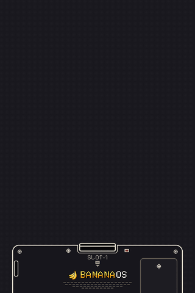
</p>

<p align="center"><b>A light Linux for the Anbernic RG DS and RG DS Plus: boots straight into ROCKNIXDS Pixel's menu,
sleeps when you close the lid, and gives the games every cycle.</b></p>

> [!WARNING]
> Banana is a pre-alpha (0.2.0). It boots and plays on both handhelds (an RG DS and an RG DS Plus run it
> day to day), but things are still missing and some are rough (see *Status*). If you try it,
> [docs/FIRST-BOOT.md](docs/FIRST-BOOT.md) says which logs to send back when something goes wrong.

> [!NOTE]
> **Made with AI.** BananaOS is developed with the help of AI: much of the code, the tests and the documentation
> was written with Claude (Anthropic) as a coding assistant, directed, reviewed and tested on real RG DS and RG DS
> Plus hardware by the project's maintainer. Bug reports and contributions from people are just as welcome.

## What it is

Banana is a whole system for the RG DS, built with Buildroot: a mainline kernel with ROCKNIX's RG DS support,
busybox init, and one program on the panels. There is no systemd, no compositor, no EmulationStation and no
desktop: the root filesystem is a read-only squashfs of a few tens of megabytes, and everything you add (games,
saves, settings) goes on an exFAT partition any computer can open.

| | |
|---|---|
| **The menu** | ROCKNIXDS Pixel, the same engine (imported unchanged from ROCKNIXDS) drawn in software straight onto both panels by `banana-ui`: the system shelf, DS cartridges with their label art, box covers, play stats, the cartridge sliding into the console. Dark and light. Banana's mark is the BananaUI bunch redrawn as pixel art in the theme's icon style, and Banana's palette is over the theme's (`tools/banana-palette.sh`): warm neutrals in place of the blue-greys, banana yellow in place of the blue accents. |
| **First boot** | A setup on the first start after the installation: Wi-Fi, the time zone, a RetroAchievements account and a ScreenScraper account (for the art, when it is fetched). The RetroAchievements account is checked with the server as soon as the password is typed, and a pop-up says whether it worked ("Logged in as ... · points", or a wrong name or password, or no connection). Skippable, and back any time from Settings > System. |
| **Settings** | Start in the menu opens six groups as tiles, in the in-game menu's look: Display & sound, Sleep & power, Nintendo DS, Other systems, Network and System. A opens a group's own list, B goes back to the tiles, L and R go to the next group. Theme, accent colour, brightness, motion, volume, sounds, clock, the boot animation; sleep when idle, the lid, the LEDs; the DS emulator, renderer, shader, 3D resolution and BananaDS's options; Wi-Fi, the networks around, file sharing; the time zone, updates, SSH, About, restart and shut down. Applied at once. |
| **Keyboard** | For Wi-Fi passwords and accounts: what is being typed sits in a field right above the keys, the selected key is the menu's yellow, and the chips at the bottom say what the buttons do (B deletes, X capitals, L symbols, Y a space, START done). Or tap the keys. |
| **Notifications** | ROCKNIXDS's look, in the menu and in DS games: the volume and brightness keys show a pill at the top of the top screen (a speaker or a sun, a 10-segment bar, the percent); RetroAchievements cards slide in along the top during a game (logged in, the game loaded with its progress, an achievement unlocked with its badge). |
| **Boot animation** | From banana-ui's first frame, while the library loads on another thread: the bunch drops onto the top panel and BANANAOS types itself in (BANANA in banana yellow, OS in white); on the bottom panel the BANANA cartridge goes into the console (the back of a DSi XL as pixel art, filling the panel: the card slot in its top edge, SLOT-1, the screws, the power light, the battery cover, the BANANAOS wordmark where the maker's is, the fine print) with the menu's own insert motion, clicks, and the power light turns green. Then it dissolves into the menu. |
| **Light** | The menu draws a frame in well under a millisecond when only one screen changes, skips any screen whose content didn't change, and sleeps in `poll()` between frames. While a game runs it closes the display, the input devices and the sound device: the game has the handheld to itself. |
| **Sleep** | Close the lid and it is asleep in a moment: the game paused where it was, the card flushed, the handheld suspended to RAM. Open it and the game carries on as the panels light up: the game and the menu are resumed first, Wi-Fi and the rest catch up behind them, and the devices resume in parallel. Woken with the lid shut (the power button in a bag) it goes straight back to sleep. While asleep it checks the battery every 4 hours and shuts down cleanly (the game saves first) before it could run flat. Two idle minutes in the menu dim the panels, ten put it to sleep; hold power to shut down. The menu warns at 20%, 10% and 5%. (`bananad`, tested in `system/bananad/tests/sleep-test.sh`) |
| **Updates** | A new version is one file dropped in `banana/updates` on the card (over Wi-Fi, with file sharing) and Settings > System > Update: it is written to the card's second system slot, checked, and runs from the next restart; the version before stays one restart away (`Previous version`). |
| **File sharing** | Switch it on in the settings and the card is on your network as `\\<address>\banana` (Windows) or `smb://<address>/banana` (Mac): copy games in and they show up in the menu. The kernel's own SMB3 server, loaded only while it is on. |
| **Other systems** | RetroArch 1.22 on one panel (top by default; the other panel and its backlight go off), KMS + GLES, with its RGUI pixel menu and cores built for the RK3566's Cortex-A55 with their ARM64 recompilers: GBA (gpSP), Game Boy (Gambatte), NES (FCEUmm), SNES (Snes9x), Mega Drive (PicoDrive), PlayStation (PCSX ReARMed), N64 (Mupen64Plus-Next). |
| **Nintendo DS** | Two emulators, chosen in Settings > Nintendo DS > Emulator ([docs/EMULATORS.md](docs/EMULATORS.md)): [SuperDrastic](https://github.com/JorreFog/SuperDrastic) (DraStic) and BananaDS (melonDS's core with SuperDrastic's display path). Both put each DS screen straight onto its own panel at 2x with a per-game CPU governor, and both have the in-game menu on L3 (save and load with pictures, quick settings, shaders). BananaDS also has RetroAchievements (the setup's account, softcore) and online play through Nintendo WFC (Kaeru), with nothing to set up; with a shader it keeps 60 frames a second on the RG DS Plus's larger panels. |
| **Apps** | Döda Kvarter and ROCKNIXDS Bank & Trade on tiles of their own, PICO-8 (fake-08, or the official PICO-8 when it is on the card), and PortMaster with its ports, as on ROCKNIX. |
| **Performance** | Every system gets a clock profile (`banana-perf`); the menu runs at the lowest clocks. |
| **Boot** | U-Boot with no delay, a kernel with the panels, buttons, touch and sound built in (no module loading before the menu), no initramfs, root mounted by the kernel, and an init script that only mounts the data partition before the menu starts. |

<p align="center">
  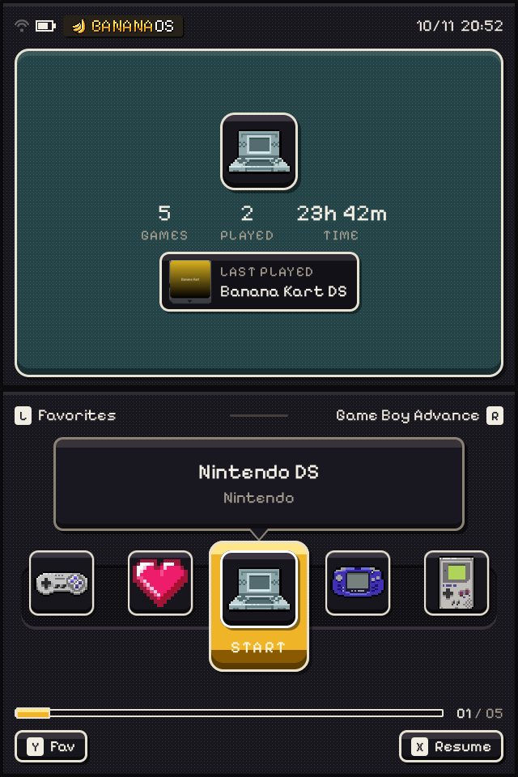
  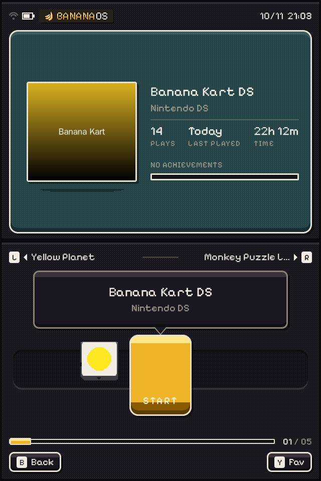
  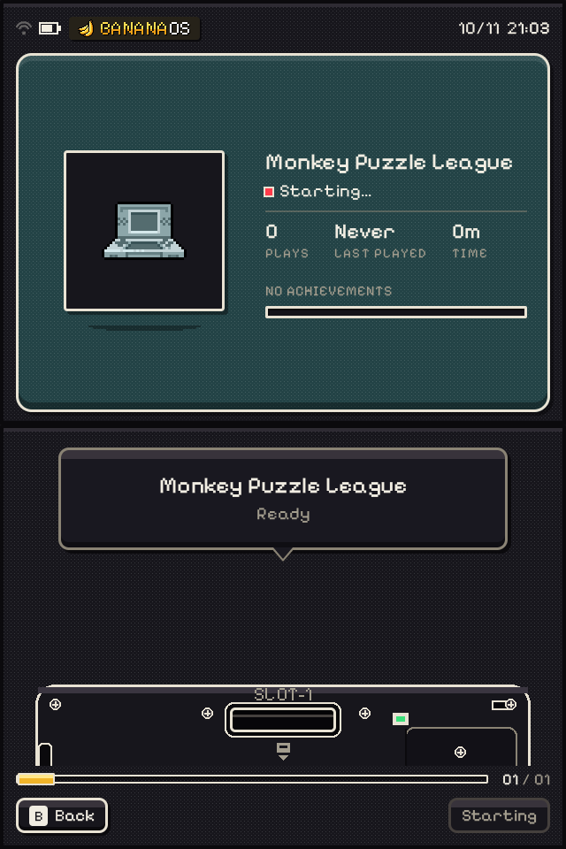
</p>
<p align="center">
  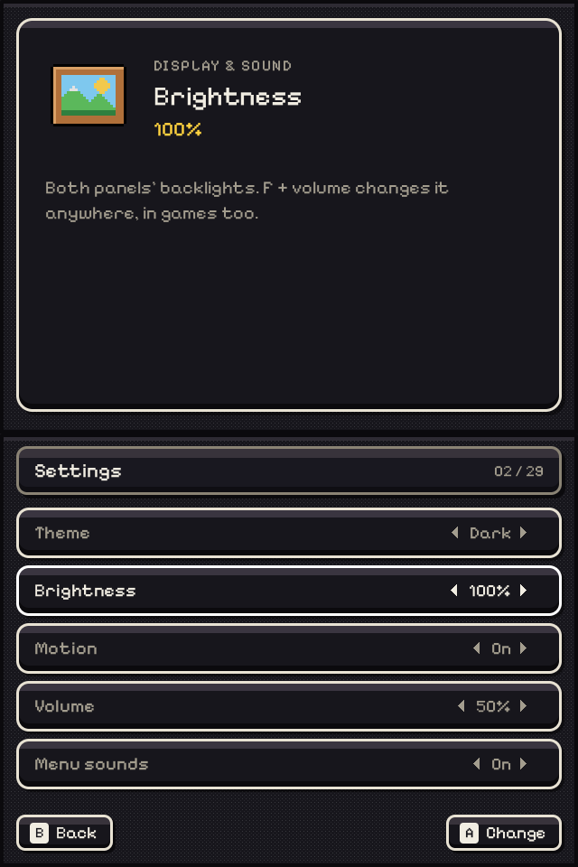
  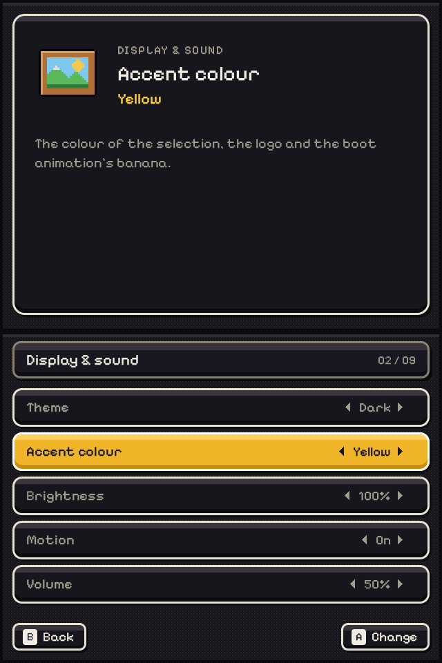
  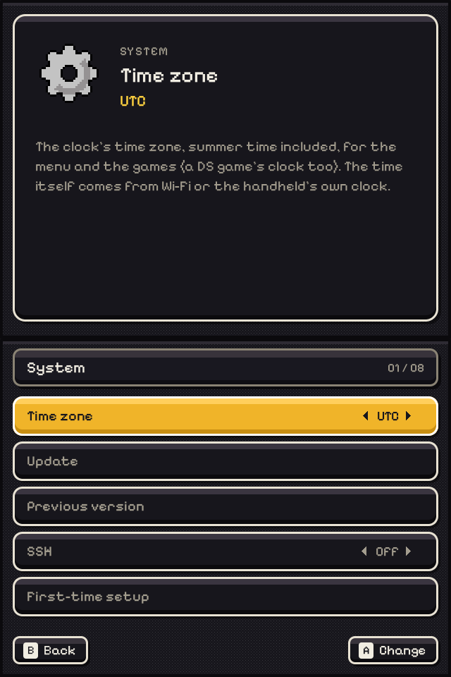
</p>
<p align="center">
  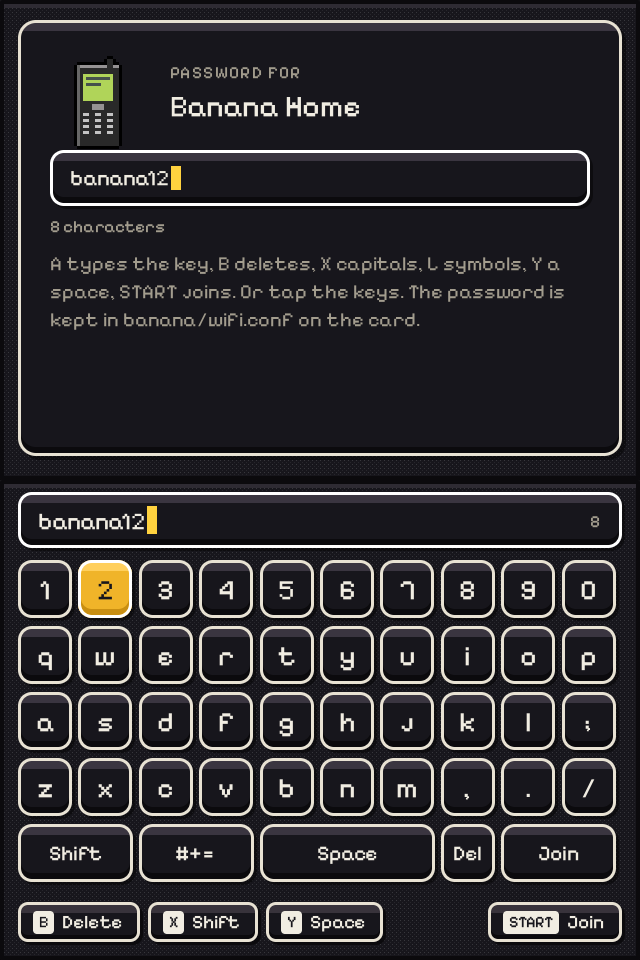
  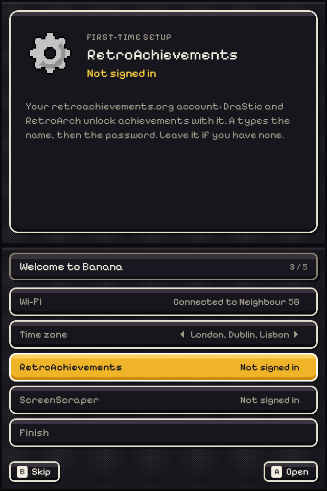
  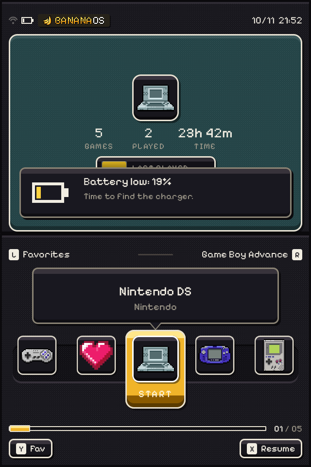
</p>
<p align="center"><sub>banana-ui's own frames (headless renders, <code>make test</code>), with a test library of made-up games.
Start opens the settings.</sub></p>
<p align="center">
  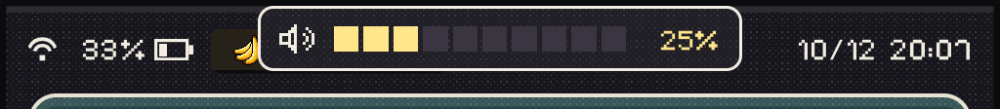
</p>
<p align="center"><sub>On an RG DS Plus: a volume key pressed in the menu (the same pill shows during DS games).</sub></p>
<p align="center">
  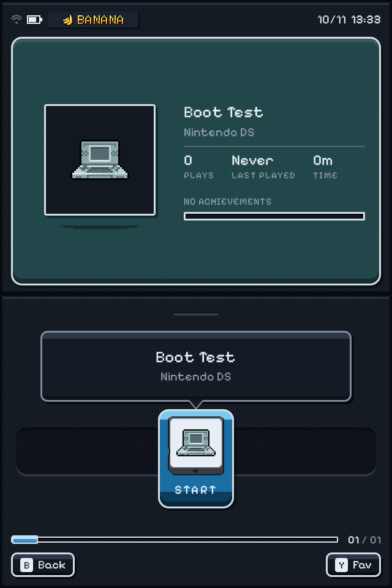
  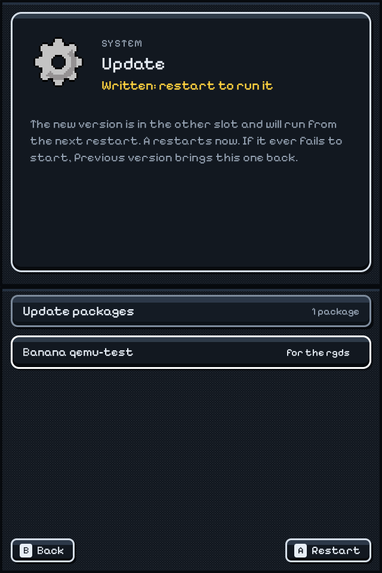 System > Update in QEMU after an update was written to the other slot: Written, restart to run it">
</p>
<p align="center"><sub>The whole image running in QEMU (<code>tools/qemu-boot.sh</code>): the kernel, init, bananad and the menu on two
virtual panels; the second picture is the update that the next boot ran from the other slot.</sub></p>

## Made for the RG DS and RG DS Plus

Banana runs on these two handhelds only, and is built around them:

- **Two panels, one menu.** Both 640x480 (or 1024x768) panels are driven directly; the menu, the boot animation and
  DS games each use them as the DS did. SuperDrastic sends each DS screen straight to its own panel.
- **60 Hz panels.** The RG DS's panels come up at 60.10 Hz; Banana's device tree carries ROCKNIXDS's measured
  retune to 60.0013 Hz, so DraStic's frames are paced without repeats. On the RG DS Plus (60.17 Hz as shipped),
  `banana-panel-tune` reads the real pixel clock on the first boot and retunes both panels to 59.999 Hz.
- **The clamshell.** Closing the lid sleeps (the hall sensor), opening it wakes the game where it was.
- **The LEDs**, as on ROCKNIX: green, red at 20%, blinking red at 5%, amber while charging, driven by the kernel's
  own LED triggers, with no polling script.
- **Sound with no sound server.** The RG DS's rk817 codec is set up as ROCKNIX sets it. On the RG DS Plus, playback
  goes to the AW88166 speaker amplifiers or to the headphones the moment they are plugged in, and the microphone
  (the DS's mic, through SuperDrastic) always records from the rk817. The volume keys follow the output.
- **DraStic tuned for it:** ROCKNIX's RG DS button map, 2x resolution, threaded 3D, SuperDrastic's Gengis Engine
  renderer and its per-game CPU governor on by default.
- **Remembered:** brightness (F + volume) and volume are restored at boot.

## Status

On the hardware (an RG DS and an RG DS Plus, October 2026):

- Both boot from the card into the menu (the RG DS Plus: the panels on at 4.4 s and the menu at 7.1 s after the
  kernel starts), updates install from Settings > System > Update into the other slot, and the first boot's
  setup, Wi-Fi and SSH work.
- DS games in both emulators with the in-game menu on L3; BananaDS keeps 60 frames a second with a shader on the
  RG DS Plus, logs in to RetroAchievements and shows its pop-ups, and has played Mario Kart DS online through
  Nintendo WFC.
- The RG DS Plus's speakers: the volume keys and Settings > Volume change both AW88166 amplifiers (their
  `Left PCM` and `Right PCM` controls, which count down: `/usr/libexec/banana/volume`), and the level is kept.
- Hundreds of games on the card (GBA, N64, SNES and DS) are listed by the menu.

Not done yet, or rough: the menu is drawn by the CPU and feels slow on the RG DS Plus's 1024x768 panels (both
panels are drawn in full on one core); scraping box art (no scraper yet: the ScreenScraper account is only kept);
Bluetooth; one card for both handhelds (each has its own image for now). See [docs/ROADMAP.md](docs/ROADMAP.md).

Off the device, in this repository's CI and by hand:

- `banana-ui` builds (x86-64 and aarch64) and renders its views at both panel sizes; `make test` checks the
  navigation, the launch, the settings' groups, the Wi-Fi pages against a stand-in `wifi` script (the network
  list, a password typed by touch, joining, forgetting, open and WPA3-only networks), the setup's accounts, the
  low-battery notice, the time zone and a DS ROM's icon read out of a `.zip`.
- `bananad`'s sleep runs against a made-up `/sys` in its own namespaces (`system/bananad/tests/sleep-test.sh`).
- The whole image boots in QEMU on every CI image build (`tools/qemu-boot.sh`): the first boot's partitioning, the
  menu on two virtual panels, a game started and the menu back, a shutdown from the settings.

## Build

On Linux (Debian/Ubuntu: `build-essential bc bison flex libssl-dev libelf-dev unzip rsync cpio python3-dev swig
libgnutls28-dev`):

```sh
make rgds          # output/rgds/images/banana-rgds.img.gz
make rgds-plus     # output/rgds-plus/images/banana-rgds-plus.img.gz
```

The first build fetches Buildroot and everything it builds, and takes an hour or more. Write the `.img.gz` to a
microSD card with balenaEtcher. On the first boot Banana makes the data partition from the rest of the card (a few
seconds); then put games in `roms/nds` and so on from any computer (see `banana/README.txt` on the card).

The whole image boots in QEMU, with no handheld (`tools/qemu-boot.sh`, and the CI's `boot` job after every image
build): the card on an emulated SD host, two 640x480 panels on a virtio GPU, a keyboard for the buttons. It runs the
first boot (the data partition made from the rest of the card), screenshots both panels, starts a game from the
library, shuts down from the settings, and reads the card's logs:

```sh
tools/qemu-boot.sh output/rgds/images/banana-rgds.img.gz        # the test; screenshots and logs in qemu-out/
tools/qemu-boot.sh output/rgds/images/banana-rgds.img.gz --interactive   # a window: arrows, Enter = A, Backspace = B
```

Working on the menu needs no handheld:

```sh
make ui            # ui/banana-ui for this computer
make test          # renders the menu from a test library into ui/tests/out
ui/banana-ui --headless out/ --assets ui/assets/rnds --roms <roms> --data <dir> \
    --script "home 0; wait 2400; shot home; press a; wait 2400; shot lib"
```

## Layout

| Path | What |
|---|---|
| `ui/` | `banana-ui`: the KMS host (`src/`), ROCKNIXDS Pixel's engine (`rnds/`, imported by `tools/import-rnds.sh`), its assets, the headless test |
| `system/bananad/` | `bananad` (sleep, lid, power button, LEDs, sound routing, volume and brightness, battery guard) and `banana-panel-tune` |
| `system/rootfs/` | init, first boot, `banana-perf`, sleep hooks, the game launchers, default settings |
| `buildroot/` | the Buildroot tree: defconfigs, Banana's packages, the RG DS board (kernel patches, device trees, drivers, U-Boot, image layout) |
| `tools/` | `import-rnds.sh` (the menu engine from ROCKNIXDS), `sync-rocknix-hw.sh` (the hardware support from ROCKNIX), the pixel bunch, the logo and the boot animation's still layers |
| `docs/` | [ARCHITECTURE.md](docs/ARCHITECTURE.md): boot, partitions, sleep, performance and the menu in detail; [FIRST-BOOT.md](docs/FIRST-BOOT.md): the first boot on the hardware, and the logs it leaves |

## Credits

The menu is ROCKNIXDS Pixel, from [ROCKNIXDS](https://github.com/JorreFog/ROCKNIXDS). Banana's mark is the
banana bunch of [BananaUI](https://github.com/JorreFog/helios), redrawn as pixel art. The RG DS's kernel support,
device trees and drivers come from [ROCKNIX](https://rocknix.org), and DS emulation is DraStic by Exophase through
SuperDrastic. Details and licenses: [THIRD_PARTY.md](THIRD_PARTY.md). Banana contains no games, ROMs or BIOS files.
