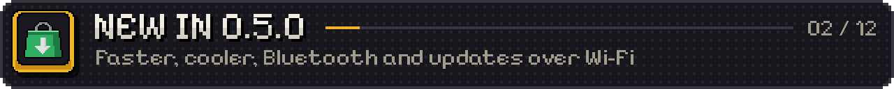
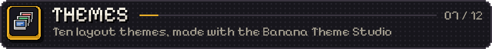
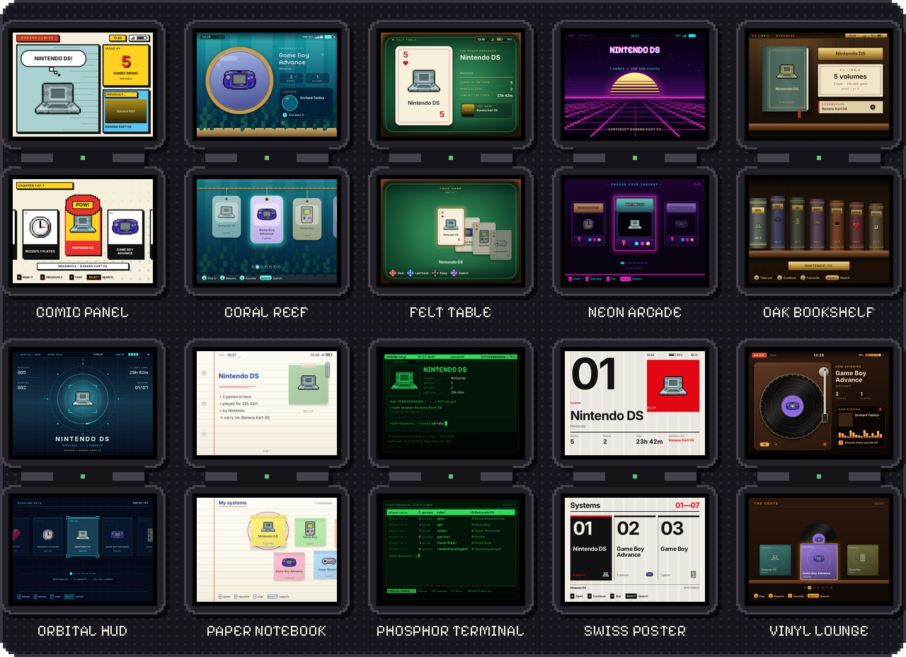

<p align="center">
  
</p>

# BananaOS

Lightweight Linux for the Anbernic RG DS and RG DS Plus.

A pixel-art menu, two DS emulators and a system built around your handheld's two screens and lid. Add your games, choose an emulator and start playing.

<p align="center">
  <a href="https://bananaos-cfw.dev">Website</a> ·
  <a href="https://github.com/JorreFog/BananaLinux/releases/tag/v0.5.0">Download</a> ·
  <a href="#get-it">Install</a> ·
  <a href="#new-in-0-5-0">What's new</a> ·
  <a href="#status">Known issues</a> ·
  <a href="https://jorrefog.github.io/BananaLinux/save-mover/">Move your saves</a> ·
  <a href="https://discord.gg/3wf73cK2Qq">Discord</a>
</p>

<p align="center">
  <a href="https://github.com/JorreFog/BananaLinux/releases"></a>
  <a href="https://github.com/JorreFog/BananaLinux/releases"></a>
  <a href="https://bananaos-cfw.dev"></a>
  
  <a href="https://discord.gg/3wf73cK2Qq"></a>
</p>

> [!WARNING]
> **Beta 0.5.0.** Tested by the QA team on both handhelds through twelve beta builds, with the known issues listed under [Status](#status). Read them before installing. If something goes wrong, [docs/FIRST-BOOT.md](docs/FIRST-BOOT.md) explains which logs to include in a report.

<a id="what-it-is"></a>


## What it is

BananaOS is a complete Linux system built specifically for the RG DS and RG DS Plus. It uses Buildroot, a Linux kernel with [ROCKNIX](https://rocknix.org) hardware support, BusyBox init and a dedicated interface for both screens. The system image is read-only; games, saves and settings live on a separate exFAT partition.

It starts directly in the menu, releases display, input and audio resources when launching a game, and pauses play when you close the lid. Updates come over Wi-Fi and install to a second system slot, so the previous version remains one restart away. The menu speaks English and Simplified Chinese (简体中文, translated by Majirefy).

<p align="center">
  
</p>
<p align="center"><sub>9.8 s from the power button to the menu (12.0 s in 0.4.2), timed with a stopwatch by a QA tester (which handheld was not recorded); BananaDS's fast-forward throughput at 2x on an RG DS Plus, average of 9 games, against 0.4.2. From the kernel starting to the menu, 0.4.2 measured 3.9 s on the RG DS and 5.9 s on the RG DS Plus.</sub></p>

<a id="new-in-0-5-0"></a>


## New in 0.5.0

The full list, with every fix: the [0.5.0 release notes](https://github.com/JorreFog/BananaLinux/releases/tag/v0.5.0).

**Nintendo DS**

- **BananaDS is 12.6% faster and runs 5 °C cooler.** A full-speed game needs about a quarter less CPU (HeartGold: Origin, ~126% → ~94% of a core). Numbers per game: [docs/PERFORMANCE-0.5.0.md](docs/PERFORMANCE-0.5.0.md).
- **3x and 4x resolution (experimental)** in BananaDS: Settings › Nintendo DS › Resolution, or per game. 4x is the RG DS Plus's native screen size; Mario Kart DS's demo races at 55–59 fps. Heavy 3D games heat the handheld at 4x; 2x stays the default.
- **Low latency, fixed (experimental):** in BananaDS a press shows about two refreshes sooner (17–23 ms from a frame's start to the screen, against 48–60 ms), now without the pitch dip and with far fewer skipped frames. SuperDrastic's low latency no longer stutters on the RG DS.
- **F + SELECT swaps the two screens** (touch follows), kept per game. **Save slots show both screens**, and the redesigned **pause menu** has save/load with pictures, quick settings, hotkeys and Restart.
- **DS cartridges** on the home row, with box art or the game's own icon, and **Power off after sleeping**: asleep on the battery for a while, the game saves itself and the handheld turns off; press power and you are back in the game.

**Bluetooth**

- **Headphones and speakers** with aptX, aptX HD, LDAC and FastStream (Low latency or Best quality), and **controllers** in the menu and the emulators. Wi-Fi keeps working while Bluetooth plays.

**Updates and your library**

- **Updates over Wi-Fi** (Settings › System › Update), checked, downloaded and verified on the handheld.
- **Home server sync** with BananaOS's own **Romhost** or with **RomM**: games, box art and saves kept in step with a server on your network. A conflict keeps both saves.
- **Delete a game** from its page; its saves stay on the card.

**Companions on the second screen**

- **Pokémon companion**, redesigned for the whole bottom screen (inspired by [PokeDaisy](https://github.com/lidor30/pokedaisy) by Lidor Itzhari): party, summary, battles with types and move effectiveness, Map, Bag, Dex and Guide. Ruby, Sapphire, Emerald, FireRed, LeafGreen and Pokémon Unbound.
- **Game companions for the Game Boy Advance** (off by default): status, items, bosses, map and progress for 500+ games. Some are still unverified: tell us when a number is wrong.

**Look and feel**

- **Ten layout themes, built in:** a theme file can now draw the whole menu, and [ten come with the system](#themes), made with the Banana Theme Studio. Pick one in Settings › Display & sound › Theme. The theme engine got 2–4x faster on the RG DS without changing a pixel.
- **A new first boot:** an arrival animation, then a step-by-step setup (language, Wi-Fi with a connection test, time zone, the DS's name, RetroAchievements, box art). Run it again from Settings › System › First-time setup.
- **Credits** (Settings › System › Credits), and the UX team's review: brightness kept across restarts, box art in a fixed frame, accent colours, L/R page jumps, stick navigation, a Power menu, Shown systems and a Hotkeys page.

**Other systems and speed**

- **N64, much faster:** rendered at the N64's native resolution, Banjo-Kazooie run unthrottled went from 64 to 126 frames a second on the RG DS Plus, and Bomberman 64 from 70% to 99% speed on the RG DS. **PlayStation:** no more stutter or crackle (Silent Hill on the RG DS Plus: 20–41 late frames and 3–6 sound dropouts per 30 s → 0). **GBA** games with RetroAchievements start in a quarter of a second instead of up to 26 s. An emulator choice per system and a screen border.
- **Boot** 12.0 s → 9.8 s from the power button to the menu (a QA tester's stopwatch; handheld not recorded); **deep sleep** works again where it got stuck in a lighter sleep.
- **Simplified Chinese (简体中文):** Majirefy's 0.5.0 translation, 610 new lines and 344 revised ones. Thank you, Majirefy! RetroArch's own menu and messages now follow the language too.

<a id="get-it"></a>


## Get it

### New installation

<p align="center">
  <a href="https://github.com/jesussaves-ai/banana-linux-flasher"></a>
</p>

Flashing erases the selected card. Back up anything on it you want to keep, and check the selected drive before you start.

The easiest route is the [BananaLinux Flasher](https://github.com/jesussaves-ai/banana-linux-flasher) by jesussaves-ai: choose your handheld, choose your microSD card, then download and flash. It fetches the newest BananaOS image, checks it against the release's SHA-256 and refuses your computer's own disks.

- Windows: download `BananaLinuxFlasher.exe` from [its releases](https://github.com/jesussaves-ai/banana-linux-flasher/releases/latest) and run it as administrator. It is an unsigned community build, so SmartScreen may ask: More info > Run anyway.
- Linux and macOS: run it from source with Python 3 and Tkinter (`python3 flash_banana.py`).

Or flash by hand: download the image for your handheld from the [0.5.0 release](https://github.com/JorreFog/BananaLinux/releases/tag/v0.5.0) and open it in [Raspberry Pi Imager](https://www.raspberrypi.com/software/) (Choose OS > Use custom image) without unzipping it. Avoid balenaEtcher: several people have found it writes the card incorrectly, and the handheld then fails to boot.

| Handheld | Image | Update package |
|---|---|---|
| RG DS Plus | [banana-rgds-plus.img.gz](https://github.com/JorreFog/BananaLinux/releases/download/v0.5.0/banana-rgds-plus.img.gz) | [banana-rgds-plus-0.5.0.update.tar](https://github.com/JorreFog/BananaLinux/releases/download/v0.5.0/banana-rgds-plus-0.5.0.update.tar) |
| RG DS | [banana-rgds.img.gz](https://github.com/JorreFog/BananaLinux/releases/download/v0.5.0/banana-rgds.img.gz) | [banana-rgds-0.5.0.update.tar](https://github.com/JorreFog/BananaLinux/releases/download/v0.5.0/banana-rgds-0.5.0.update.tar) |

Insert the card and power on. The first boot prepares your data partition, plays its arrival animation, then guides you through setup step by step: language, Wi-Fi with a connection test, time zone, your DS's name, a RetroAchievements account and box art. Skip any step with B, or the whole setup with START. To add games, open the `BANANA` drive on your computer and copy them into `roms/nds`, `roms/gba` and the other system folders, or copy them over Wi-Fi. `banana/README.txt` on the card lists the folders.

<a id="update"></a>
### Update an existing installation

- **From 0.4.x:** put `banana-rgds-plus-0.5.0.update.tar` (RG DS Plus) or `banana-rgds-0.5.0.update.tar` (RG DS) in `banana/updates` on the card, then Settings › System › Update, A on the package and A again. It installs to the card's other system slot and runs from the next restart; the version you had stays one restart away (Settings › System › Previous version). Games, saves and settings stay.
- **From a 0.5.0 beta:** Settings › System › Update finds 0.5.0 over Wi-Fi. Beta testers: switch Beta channel off there to follow the releases from now on.
- **From 0.5.0 on, updates come over Wi-Fi:** Settings › System › Update checks the releases, downloads the package for your handheld and checks it before installing. If a package ever says it is damaged, download it again and compare its SHA-256 with the release's `SHA256SUMS` file.

The first start after the update runs the new first-time setup once, prefilled with what your card already has.

### Move your saves

Coming from GammaOS or ROCKNIX? The [Save Mover](https://jorrefog.github.io/BananaLinux/save-mover/) backs up your saves, converts them and places them in the card's folders, all in your browser. A ROCKNIX `.dsv` next to a game is used as its save the first time.

<a id="a-tour"></a>


## A tour

A look around BananaOS, captured on an RG DS Plus running 0.4.2. For 0.5.0's layout themes, see [Themes](#themes).

<table>
  <tr>
    <td align="center" width="33%"><br><sub>Home: your systems, recent games and play stats.</sub></td>
    <td align="center" width="33%"><br><sub>Library: box art, play time and achievement progress.</sub></td>
    <td align="center" width="33%"><br><sub>Per-game options: choose an emulator and settings for each game.</sub></td>
  </tr>
  <tr>
    <td align="center"><br><sub>In play: one DS screen on each display.</sub></td>
    <td align="center"><br><sub>In-game menu: save, load and adjust quick settings.</sub></td>
    <td align="center"><br><sub>App Store: install and update apps from the menu.</sub></td>
  </tr>
  <tr>
    <td align="center"><br><sub>Settings: six groups, with help on the top screen.</sub></td>
    <td align="center"><br><sub>Light theme: the same interface in a lighter palette.</sub></td>
    <td align="center"><br><sub>Carts: browse your games on a 3D shelf. Experimental.</sub></td>
  </tr>
  <tr>
    <td align="center"><br><sub>Simplified Chinese: translation by Majirefy.</sub></td>
    <td align="center"><br><sub>Simplified Chinese settings.</sub></td>
    <td align="center"> Nintendo DS: Emulator BananaDS, Quick resume, DS language, DS name, Shader LCD grid 2x"><br><sub>Nintendo DS settings: emulator, shader, DS language and name.</sub></td>
  </tr>
</table>

<p align="center">
  
</p>
<p align="center"><sub>The boot animation.</sub></p>

<a id="nintendo-ds"></a>


## Nintendo DS: two emulators, your choice

<p align="center">
  
</p>

Both put each DS screen on its own display and include an in-game menu for save states, shaders and quick settings. Choose a default in Settings > Nintendo DS, or press X in the library to choose one for a game.

| | [SuperDrastic](https://github.com/JorreFog/SuperDrastic) | BananaDS |
|---|---|---|
| Core | DraStic by Exophase, adapted for the RG DS and RG DS Plus | The melonDS core on BananaOS's display path and menu |
| 3D | Gengis Engine at 2x, threaded | Gengis Engine at 2x, threaded; 3x and 4x (experimental) |
| Low latency (experimental) | Yes | Yes: a press shows about two refreshes sooner |
| CPU clocks | Per-game tuning | Steps down only when the heaviest frames still fit |
| RetroAchievements | No | Softcore, with the account from setup |
| Online play | No | Nintendo WFC through Kaeru |
| Microphone | A "blow" key | The real microphone |
| Extras | Shaders, save slots with both screens as their picture | Cheats for 4,000+ games, fast-forward (R2), FPS counter, screenshots (F + L2), save slots with both screens as their picture |

Press F or L3 for the in-game menu. The Anbernic button also opens it. F + SELECT swaps the two screens. More in [docs/EMULATORS.md](docs/EMULATORS.md), the contract between the menu and any emulator.

<a id="and-the-rest"></a>


## More systems, apps and ports

- RetroArch systems: GBA, Game Boy, NES, SNES, Mega Drive, PlayStation and N64, on one screen. The other screen holds touch tiles for save, load, menu, fast-forward and quit, or a game companion. Shaders and a screen border are included (Settings > Other systems), and each system can use its own emulator.
- Companions on the second screen: the Pokémon companion for Ruby, Sapphire, Emerald, FireRed, LeafGreen and Pokémon Unbound, and game companions for 500+ GBA games (off by default). More in [docs/COMPANIONS.md](docs/COMPANIONS.md).
- PortMaster and PICO-8: PortMaster with its ports, as on ROCKNIX; PICO-8 through fake-08, or the official PICO-8 when it is on the card.
- App Store: install and update Döda Kvarter, Poketool (a Pokémon bank and save editor) and eReaderDS from the menu.
- Search and artwork: search names, genres or years across every system (Select), Recently played and Favorites shelves, box art from libretro or [TwilightBoxart](https://boxart.kirovair.com/), and games on a second SD card on the RG DS Plus.
- Your library on a home server: sync games, box art and saves with BananaOS's own Romhost or with RomM (Settings › Network › Home server).
- Files: copy, move, rename and delete files and folders, and make folders, on the card and the RG DS Plus's second SD card, from a tile on the home screen (it stays open while it copies; Y twice stops). It also gets games from a NAS or a computer over SMB, SFTP or FTP(S): into the folder their type says, or any folder chosen (or made) on either card, or pasted where you want them. A cut download resumes where it stopped, whatever the protocol; zip, 7z and RAR archives are unpacked (multi-volume and password-protected ones as well), and archives already on a card too. Close the lid and the download finishes before the handheld sleeps.
- File sharing: over Wi-Fi the card is `\\<address>\banana` (log in as `banana` / `linux`). Copied games show up in the menu.

| System | RetroArch core (RetroArch 1.22, built for the RK3566's Cortex-A55) |
|---|---|
| GBA | gpSP or mGBA |
| Game Boy | Gambatte |
| NES | FCEUmm |
| SNES | Snes9x |
| Mega Drive | PicoDrive |
| PlayStation | PCSX ReARMed |
| N64 | Mupen64Plus-Next |

<a id="themes"></a>


## Themes

In 0.5.0 a theme file can draw the whole menu: where everything is, how it looks and how it moves. Ten layout themes come built in: pick one in **Settings › Display & sound › Theme** (A opens a gallery with previews). They were made with the **Banana Theme Studio**, the theme editor that runs in your browser.

<p align="center">
  
</p>
<p align="center"><sub>Each theme's home screen, top over bottom, as the Banana Theme Studio draws it.</sub></p>

- Make your own, or edit one of these: open the [Banana Theme Studio](https://jorrefog.github.io/BananaLinux/theme-studio/). Nothing to install, and nothing you make leaves your computer.
- Put your theme in `banana/themes/` on the card (over file sharing, or with the card in a computer), then pick it in Settings. A file there with the same name as a built-in theme replaces it. Pick **Dark** to go straight back to the normal look.
- The guide: [docs/MAKE-A-THEME.md](docs/MAKE-A-THEME.md). The file format: [docs/THEMES.md](docs/THEMES.md).

<a id="made-for-it"></a>


## Built for two screens and a lid

- Suspend and resume: close the lid and the game pauses, the card is flushed and the handheld sleeps. Open it and the game carries on. Woken in a bag, it goes back to sleep. With Power off after sleeping, a long sleep on the battery saves the game and turns the handheld off; press power and you are back in it.
- Sound without setup: the speakers or headphones switch the moment headphones are plugged in, during a game too. Bluetooth headphones and speakers work as well, with aptX, aptX HD, LDAC and FastStream.
- Battery care: while asleep it checks the battery and shuts down cleanly before it runs flat. The LEDs work as on ROCKNIX: green, red at 20%, blinking red at 5%, amber while charging.

<details>
<summary>Hardware details</summary>

- Both 640x480 (RG DS) or 1024x768 (RG DS Plus) screens are driven directly, with no compositor.
- The RG DS's screens are retuned from 60.10 Hz to 60.0013 Hz in the device tree; on the RG DS Plus, `banana-panel-tune` reads the real pixel clock on the first boot and retunes both screens to 59.999 Hz.
- No sound server: audio goes to the RG DS Plus's AW88166 amplifiers or the headphones directly; the microphone records from the rk817 at full level.

</details>

<a id="status"></a>


## Status and known issues

0.5.0 is a beta. The QA team tested it on both handhelds through 0.5.0-beta.1 to beta.12 (a 36-item test plan), with every confirmed report fixed or listed below. Both update packages were installed over earlier builds through Settings › System › Update and over Wi-Fi from the beta channel, and every speed claim was measured on the handhelds' own screens. These are checks of this release, not a compatibility guarantee.

Known issues:

- **DSi games and DSiWare** (.dsi, .cia; unpack a .7z first) run on BananaDS with the BIOS dumped from your own DSi: put `dsi_bios9.bin` and `dsi_bios7.bin` (64 KB each; a dump's `DSI_bios9.bin` names and a `DSi BIOS` folder inside it work too) in `bios/` on the card. Your DSi's NAND (`dsi_nand.bin`, optional) goes there too; without it BananaDS keeps DSiWare saves on a NAND of its own. Without the BIOS they stop at a white screen. DSi-enhanced DS games (Pokémon Black 2 / White 2) run as DS games.
- **SuperDrastic's low latency on the RG DS Plus** is a little rougher than with it off: DraStic runs at 60.0 fps and the Plus's panels at 60.17 Hz. BananaDS's low latency is smooth on both.
- **The heaviest themes** (Neon Arcade, Vinyl Lounge, Oak Bookshelf) can still drop frames while scrolling the home row.
- **Chinese:** lines added after Majirefy's 0.5.0 translation (the first-time setup's slides, the new low-latency help texts, a few Credits lines) still show in English or as a draft, for the next round.
- **RetroAchievements** shows "Achievement Unlocked: Unsupported Game Version" for a game it doesn't recognise; nothing is unlocked.
- **4x resolution** heats the handheld in heavy 3D games; use 2x for long sessions.
- **A DS game can freeze after a very long sleep** (reported after 2 hours with the lid shut): the in-game menu still works and quitting is fine. Being investigated.
- **Bluetooth headphones** were tested with a SteelSeries headset (and AirPods on an earlier beta); tell us how others do.

Not available yet:

- Charging while switched off on the RG DS Plus ([#34](https://github.com/JorreFog/BananaLinux/issues/34)).
- One card image for both handhelds: each has its own image for now.

What's next: [docs/ROADMAP.md](docs/ROADMAP.md). Every release's notes: [Releases](https://github.com/JorreFog/BananaLinux/releases).

<a id="build"></a>


## Build

### Build from source

On Linux (Debian/Ubuntu: `build-essential bc bison flex libssl-dev libelf-dev unzip rsync cpio python3-dev swig libgnutls28-dev`). The released 0.5.0 is the tag `v0.5.0`:

```sh
make rgds          # output/rgds/images/banana-rgds.img.gz
make rgds-plus     # output/rgds-plus/images/banana-rgds-plus.img.gz
```

The first build fetches Buildroot and everything it builds, and takes an hour or more. The whole image boots in QEMU with no handheld (`tools/qemu-boot.sh`, also the CI's `boot` job): the first boot, the menu on two virtual panels, a game started from the library, a shutdown from the settings.

### Work on the menu

No handheld needed:

```sh
make ui            # ui/banana-ui for this computer
make test          # renders the menu from a test library into ui/tests/out
```

| Path | What |
|---|---|
| `ui/` | `banana-ui`: the KMS host (`src/`), ROCKNIXDS Pixel's engine (`rnds/`), its assets, the headless tests |
| `system/bananad/` | `bananad` (sleep, lid, power button, LEDs, sound routing, volume and brightness, battery guard) and `banana-panel-tune` |
| `system/rootfs/` | init, first boot, `banana-perf`, sleep hooks, the game launchers, default settings |
| `buildroot/` | defconfigs, Banana's packages, the RG DS board (kernel patches, device trees, drivers, U-Boot, image layout) |
| `store/` | the App Store's catalogue |
| `tools/` | the menu engine's import, ROCKNIX's hardware sync, the pixel bunch, the logo, the boot animation, the Banana Theme Studio (`theme-studio/`), this page's pictures (`make-readme-art.py`) |
| `web/` | the website on GitHub Pages: the [Save Mover](https://jorrefog.github.io/BananaLinux/save-mover/), with the [Banana Theme Studio](https://jorrefog.github.io/BananaLinux/theme-studio/) (`tools/theme-studio/`) published next to it |
| `docs/` | [ARCHITECTURE.md](docs/ARCHITECTURE.md), [EMULATORS.md](docs/EMULATORS.md), [FIRST-BOOT.md](docs/FIRST-BOOT.md), [COMPANIONS.md](docs/COMPANIONS.md), [MAKE-A-THEME.md](docs/MAKE-A-THEME.md), [THEMES.md](docs/THEMES.md), [THEME-EDITOR.md](docs/THEME-EDITOR.md), [PERFORMANCE-0.5.0.md](docs/PERFORMANCE-0.5.0.md), [ROADMAP.md](docs/ROADMAP.md) |

<a id="seen-on-youtube"></a>


## See BananaOS in action

<table>
  <tr>
    <td align="center" width="50%">
      <a href="https://www.youtube.com/watch?v=yW6LavgyhL4&t=948s"></a><br>
      <sub><a href="https://www.youtube.com/@RetroGameCorps">Retro Game Corps</a>: Custom Firmware on the Anbernic RG DS Plus. BananaOS from 15:48.</sub>
    </td>
    <td align="center" width="50%">
      <a href="https://www.youtube.com/watch?v=KPENdDlkI5M"></a><br>
      <sub><a href="https://www.youtube.com/@forthenext">forthenext</a>: ANBERNIC RG DS Plus, BananaOS and your games tested.</sub>
    </td>
  </tr>
</table>
<p align="center"><sub>Thank you both! Made a video about BananaOS? Tell us on <a href="https://discord.gg/3wf73cK2Qq">Discord</a>.</sub></p>

<a id="credits"></a>


## Built on community work

The people who made 0.5.0 (also in Settings › System › Credits):

- **Development:** JorreFog (maintainer) · jesussaves-ai · marlupatrocinio
- **Translation:** Majirefy (简体中文, Simplified Chinese)
- **QA:** Duncan · Majirefy · Smizzle · nigel777 · v (QA and mod)
- **UI/UX:** Numberjerry

Thanks to:

- Majirefy for the Simplified Chinese (简体中文) translation. The characters are drawn with [Fusion Pixel Font](https://github.com/TakWolf/fusion-pixel-font) (缝合像素字体) by TakWolf. To translate BananaOS into your language, ask for the translation document; `tools/lang-from-docx.py` turns a filled-in one into `ui/assets/lang/<language>.tsv`.
- jesussaves-ai: the [BananaLinux Flasher](https://github.com/jesussaves-ai/banana-linux-flasher), the card writer for Windows, Linux and macOS, and in BananaOS the PS1 game panel, the game panel's idle dimming, the microphone routing and the Reset rows.
- casualducko: the zero-copy panel patch for LÖVE apps on both panels (eReaderDS).
- swouapiy: the shutdown animation (the boot animation backwards).
- The Pokémon companion is inspired by [PokeDaisy](https://github.com/lidor30/pokedaisy) by Lidor Itzhari (lidor30), the companion app for Android handhelds with two screens. BananaOS's is its own code, written from the games' documented data.
- The menu is ROCKNIXDS Pixel, from [ROCKNIXDS](https://github.com/JorreFog/ROCKNIXDS), where BananaOS started. Banana's mark is the bunch of [BananaUI](https://github.com/JorreFog/helios), redrawn as pixel art.
- The RG DS's kernel support, device trees and drivers come from [ROCKNIX](https://rocknix.org). DS emulation is DraStic by Exophase (through [SuperDrastic](https://github.com/JorreFog/SuperDrastic)) and [melonDS](https://melonds.kuribo64.net/)'s core (BananaDS).
- [Retro Game Corps](https://www.youtube.com/@RetroGameCorps) and [forthenext](https://www.youtube.com/@forthenext) for showing BananaOS to a lot of people, and GammaOS for all the inspiration.

### Development and AI

Much of the code, tests and documentation was developed with Claude as a coding assistant. The maintainer directs, reviews and tests the work on real hardware. Bug reports and contributions are welcome.

### Licenses

BananaOS is MIT licensed ([LICENSE](LICENSE)); bundled components keep their own licenses, listed in [THIRD_PARTY.md](THIRD_PARTY.md). BananaOS contains no games, ROMs or BIOS files.

<p align="center"><a href="https://discord.gg/3wf73cK2Qq"><b>Questions, reports, setups: join the Discord</b></a></p>
