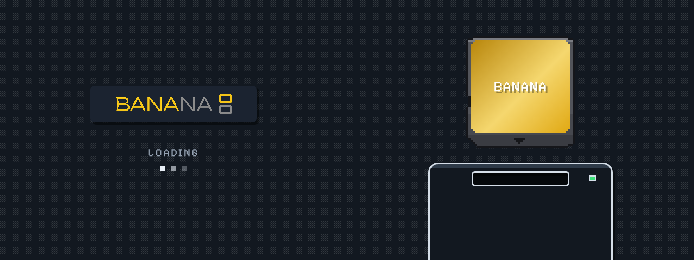

<p align="center">
  
</p>

<p align="center"><b>A light Linux for the Anbernic RG DS and RG DS Plus: boots straight into ROCKNIXDS Pixel's menu,
sleeps when you close the lid, and gives the games every cycle.</b></p>

> [!WARNING]
> Banana is at its start (0.1.0-dev). Everything here builds and is tested off the device (see *Status*), but no
> image has booted on an RG DS yet. Don't flash it expecting a working handheld.

## What it is

Banana is a whole system for the RG DS, built with Buildroot: a mainline kernel with ROCKNIX's RG DS support,
busybox init, and one program on the panels. There is no systemd, no compositor, no EmulationStation and no
desktop: the root filesystem is a read-only squashfs of a few tens of megabytes, and everything you add (games,
saves, settings) goes on an exFAT partition any computer can open.

| | |
|---|---|
| **The menu** | ROCKNIXDS Pixel, the same engine (imported unchanged from ROCKNIXDS) drawn in software straight onto both panels by `banana-ui`: the system shelf, DS cartridges with their label art, box covers, play stats, the cartridge sliding into the console. Dark and light. |
| **Light** | The menu draws a frame in well under a millisecond when only one screen changes, skips any screen whose content didn't change, and sleeps in `poll()` between frames. While a game runs it closes the display, the input devices and the sound device: the game has the handheld to itself. |
| **Sleep** | Close the lid or tap power: the game is paused, the handheld suspends to RAM, and opening the lid wakes it where you left off. Ten idle minutes in the menu do the same. Hold power to shut down. A battery about to run out shuts down cleanly. (`bananad`) |
| **Performance** | DS games run through [SuperDrastic](https://github.com/JorreFog/SuperDrastic): each DS screen straight to its own panel, 2x resolution, its own per-game CPU governor. Every system gets a clock profile (`banana-perf`); the menu runs at the lowest clocks. |
| **Boot** | U-Boot with no delay, a kernel with the panels, buttons, touch and sound built in (no module loading before the menu), no initramfs, root mounted by the kernel, and an init script that only mounts the data partition before the menu starts. |

<p align="center">
  
  
  
</p>
<p align="center"><sub>banana-ui's own frames (headless renders, <code>make test</code>), with a test library of made-up games.</sub></p>

## Status

Built and checked in this repository's CI and by hand:

- `banana-ui` builds (x86-64 and aarch64) and renders all three views at both panel sizes; ROCKNIXDS Pixel's
  frames are pixel-identical to the engine's own output apart from Banana's logo. `make test` checks the
  navigation and the launch.
- `bananad` builds without warnings for aarch64.
- Both Buildroot defconfigs load in Buildroot 2026.02.3 with every option kept.
- ROCKNIX's 45 RK3566 kernel patches plus the input-polldev patch apply cleanly to Linux 7.2.7, the kernel config
  fragment applies as written, and the whole kernel builds (a 25 MB `Image`) with the panels, joypad, touch, codec,
  amplifiers and battery built in; the RG DS and RG DS Plus device trees compile.

Not done yet: a full image build (it needs the network access Buildroot downloads with; the CI's `image` job does
it), and anything on the hardware: the boot time, suspend and resume of the panels and Wi-Fi, the panels' handover
to SuperDrastic. See [docs/ROADMAP.md](docs/ROADMAP.md).

## Build

On Linux (Debian/Ubuntu: `build-essential bc bison flex libssl-dev libelf-dev unzip rsync cpio python3-dev swig
libgnutls28-dev`):

```sh
make rgds          # output/rgds/images/banana-rgds.img.gz
make rgds-plus     # output/rgds-plus/images/banana-rgds-plus.img.gz
```

The first build fetches Buildroot and everything it builds, and takes an hour or more. Write the `.img.gz` to a
microSD card with balenaEtcher. On the first boot Banana makes the data partition from the rest of the card (a few
seconds); then put games in `roms/nds` and so on from any computer (see `banana/README.txt` on the card).

Working on the menu needs no handheld:

```sh
make ui            # ui/banana-ui for this computer
make test          # renders the menu from a test library into ui/tests/out
ui/banana-ui --headless out/ --assets ui/assets/rnds --roms <roms> --data <dir> \
    --script "home 0; wait 2400; shot home; press a; wait 2400; shot lib"
```

## Layout

| Path | What |
|---|---|
| `ui/` | `banana-ui`: the KMS host (`src/`), ROCKNIXDS Pixel's engine (`rnds/`, imported by `tools/import-rnds.sh`), its assets, the headless test |
| `system/bananad/` | the power daemon: sleep, lid, power button, volume and brightness keys, battery guard |
| `system/rootfs/` | init, first boot, `banana-perf`, sleep hooks, the game launchers, default settings |
| `buildroot/` | the Buildroot tree: defconfigs, Banana's packages, the RG DS board (kernel patches, device trees, drivers, U-Boot, image layout) |
| `tools/` | `import-rnds.sh` (the menu engine from ROCKNIXDS), `sync-rocknix-hw.sh` (the hardware support from ROCKNIX), the logo and splash |
| `docs/` | [ARCHITECTURE.md](docs/ARCHITECTURE.md): boot, partitions, sleep, performance and the menu in detail |

## Credits

The menu is ROCKNIXDS Pixel, from [ROCKNIXDS](https://github.com/JorreFog/ROCKNIXDS). The RG DS's kernel support,
device trees and drivers come from [ROCKNIX](https://rocknix.org), and DS emulation is DraStic by Exophase through
SuperDrastic. Details and licenses: [THIRD_PARTY.md](THIRD_PARTY.md). Banana contains no games, ROMs or BIOS files.
