<p align="center">
  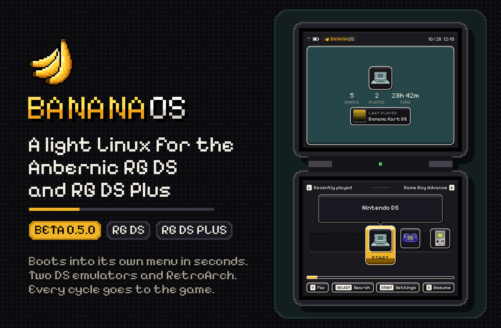
</p>

# BananaOS

Lightweight Linux for the Anbernic RG DS and RG DS Plus.

A pixel-art menu, two DS emulators and a system built around your handheld's two screens and lid. Add your games,
choose an emulator and start playing.

<p align="center">
  <a href="https://bananaos-cfw.dev">Website</a> ·
  <a href="https://github.com/JorreFog/BananaLinux/releases/tag/v0.4.2">Download</a> ·
  <a href="#get-it">Install</a> ·
  <a href="#status">Known issues</a> ·
  <a href="https://jorrefog.github.io/BananaLinux/save-mover/">Move your saves</a> ·
  <a href="https://discord.gg/3wf73cK2Qq">Discord</a>
</p>

<p align="center">
  <a href="https://github.com/JorreFog/BananaLinux/releases"></a>
  <a href="https://github.com/JorreFog/BananaLinux/releases"></a>
  <a href="https://bananaos-cfw.dev"></a>
  
  <a href="https://discord.gg/3wf73cK2Qq"></a>
</p>

> [!WARNING]
> Alpha 0.4.2. Tested on the maintainer's RG DS and RG DS Plus, with known issues and unfinished features.
> Read [Status](#status) before installing. If something goes wrong, [docs/FIRST-BOOT.md](docs/FIRST-BOOT.md)
> explains which logs to include in a report.

<a id="what-it-is"></a>
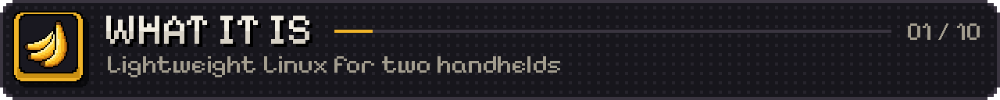

## What it is

BananaOS is a complete Linux system built specifically for the RG DS and RG DS Plus. It uses Buildroot, a Linux
kernel with [ROCKNIX](https://rocknix.org) hardware support, BusyBox init and a dedicated interface for both
screens. The system image is read-only; games, saves and settings live on a separate exFAT partition.

It starts directly in the menu, releases display, input and audio resources when launching a game, and pauses play
when you close the lid. Updates install to a second system slot so the previous version remains available.

<p align="center">
  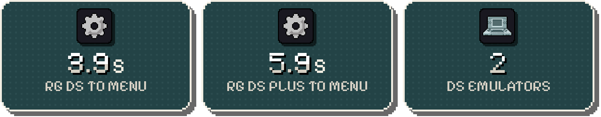
</p>
<p align="center"><sub>Boot times are from the kernel starting to the menu showing, measured on 0.4.2.</sub></p>

<a id="get-it"></a>
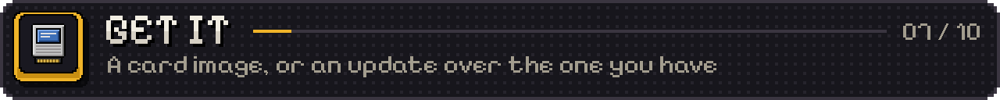

## Get it

### New installation

<p align="center">
  <a href="https://github.com/jesussaves-ai/banana-linux-flasher">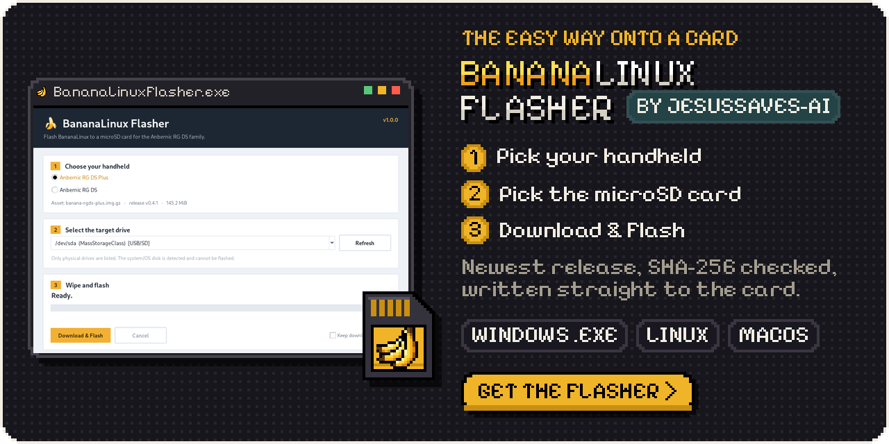</a>
</p>

Flashing erases the selected card. Back up anything on it you want to keep, and check the selected drive
before you start.

The easiest route is the [BananaLinux Flasher](https://github.com/jesussaves-ai/banana-linux-flasher) by
jesussaves-ai: choose your handheld, choose your microSD card, then download and flash. It fetches the newest
BananaOS image, checks it against the release's SHA-256 and refuses your computer's own disks.

- Windows: download `BananaLinuxFlasher.exe` from [its releases](https://github.com/jesussaves-ai/banana-linux-flasher/releases/latest)
  and run it as administrator. It is an unsigned community build, so SmartScreen may ask: More info > Run anyway.
- Linux and macOS: run it from source with Python 3 and Tkinter (`python3 flash_banana.py`).

Or flash by hand: download the image for your handheld from the [0.4.2 release](https://github.com/JorreFog/BananaLinux/releases/tag/v0.4.2) and
open it in [balenaEtcher](https://etcher.balena.io/) without unzipping it.

| Handheld | Image | Update package |
|---|---|---|
| RG DS Plus | [banana-rgds-plus.img.gz](https://github.com/JorreFog/BananaLinux/releases/download/v0.4.2/banana-rgds-plus.img.gz) | [banana-rgds-plus-0.4.2.update.tar](https://github.com/JorreFog/BananaLinux/releases/download/v0.4.2/banana-rgds-plus-0.4.2.update.tar) |
| RG DS | [banana-rgds.img.gz](https://github.com/JorreFog/BananaLinux/releases/download/v0.4.2/banana-rgds.img.gz) | [banana-rgds-0.4.2.update.tar](https://github.com/JorreFog/BananaLinux/releases/download/v0.4.2/banana-rgds-0.4.2.update.tar) |

Insert the card and power on. The first boot prepares your data partition, then guides you through setup: Wi-Fi,
time zone, your DS's name and a RetroAchievements account. Every step is optional. To add games, open the `BANANA`
drive on your computer and copy them into `roms/nds`, `roms/gba` and the other system folders, or copy them over
Wi-Fi. `banana/README.txt` on the card lists the folders.

<a id="update"></a>
### Update an existing installation

From 0.4.0 or 0.4.1: copy the matching `.update.tar` package to `banana/updates` on your card. Open Settings >
System > Update, select the package and confirm. The update preserves games, saves and settings. Back up your saves
before updating.

### Move your saves

Coming from GammaOS or ROCKNIX? The [Save Mover](https://jorrefog.github.io/BananaLinux/save-mover/) backs up your
saves, converts them and places them in the card's folders, all in your browser. A ROCKNIX `.dsv` next to a game is
used as its save the first time.

<a id="a-tour"></a>
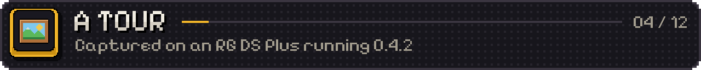

## A tour

A look around BananaOS. Captured on an RG DS Plus running 0.4.2.

<table>
  <tr>
    <td align="center" width="33%">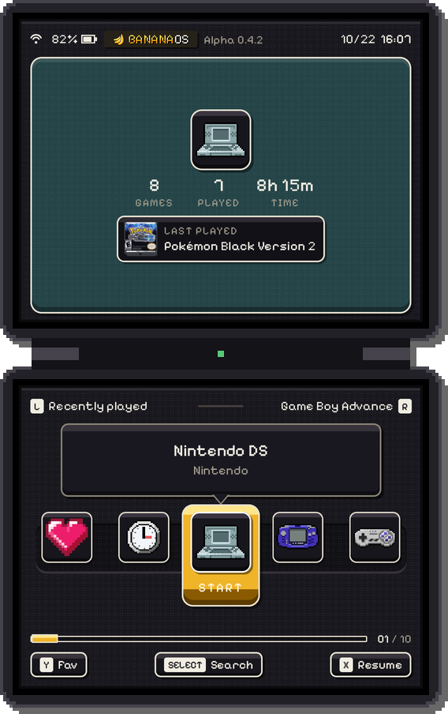<br><sub>Home: your systems, recent games and play stats.</sub></td>
    <td align="center" width="33%">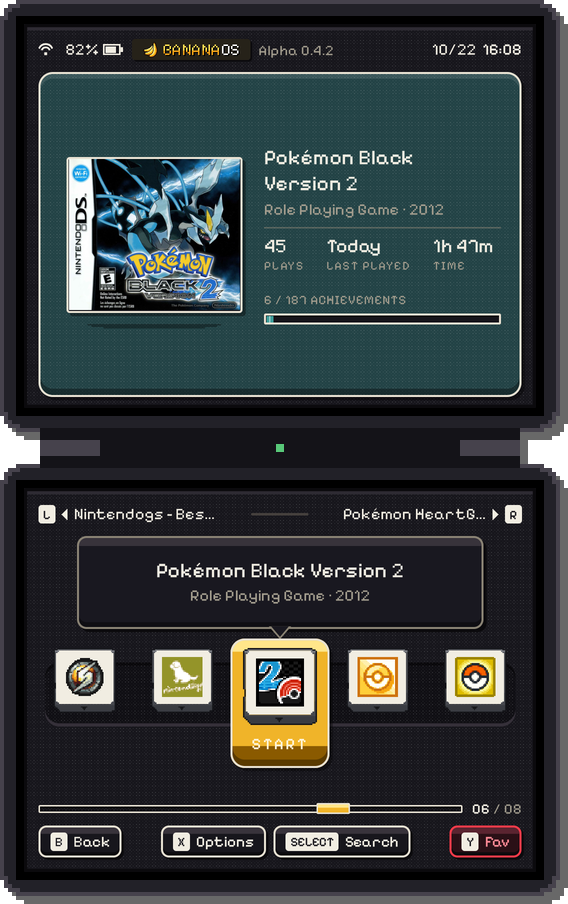<br><sub>Library: box art, play time and achievement progress.</sub></td>
    <td align="center" width="33%">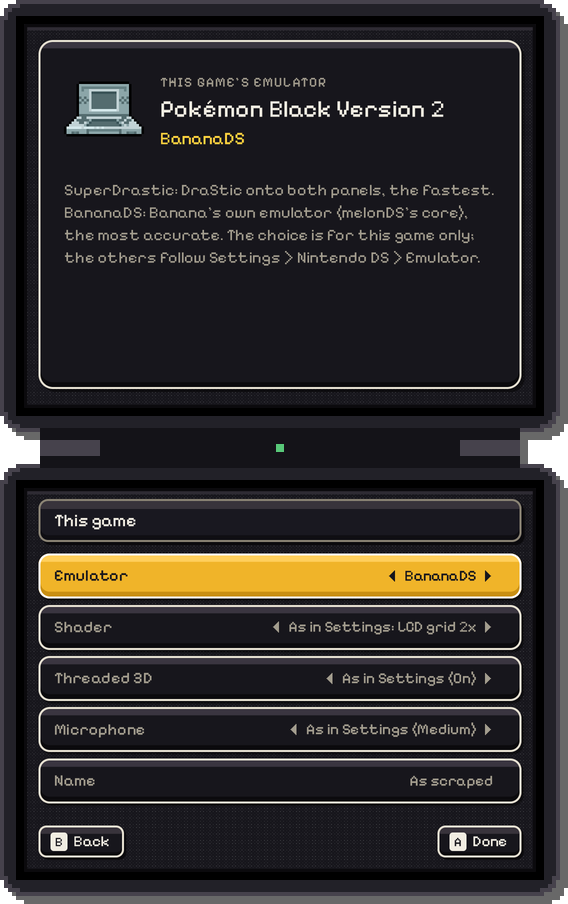<br><sub>Per-game options: choose an emulator and settings for each game.</sub></td>
  </tr>
  <tr>
    <td align="center">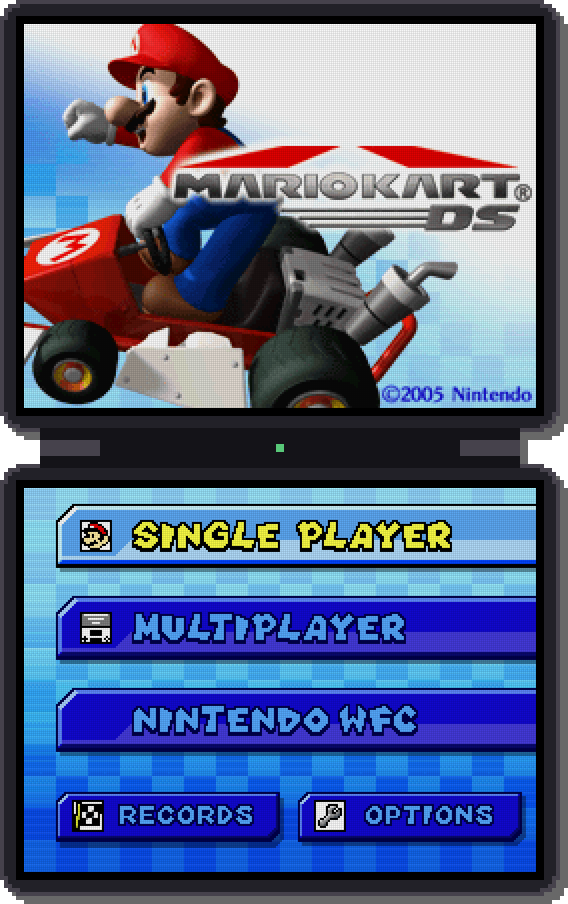<br><sub>In play: one DS screen on each display.</sub></td>
    <td align="center">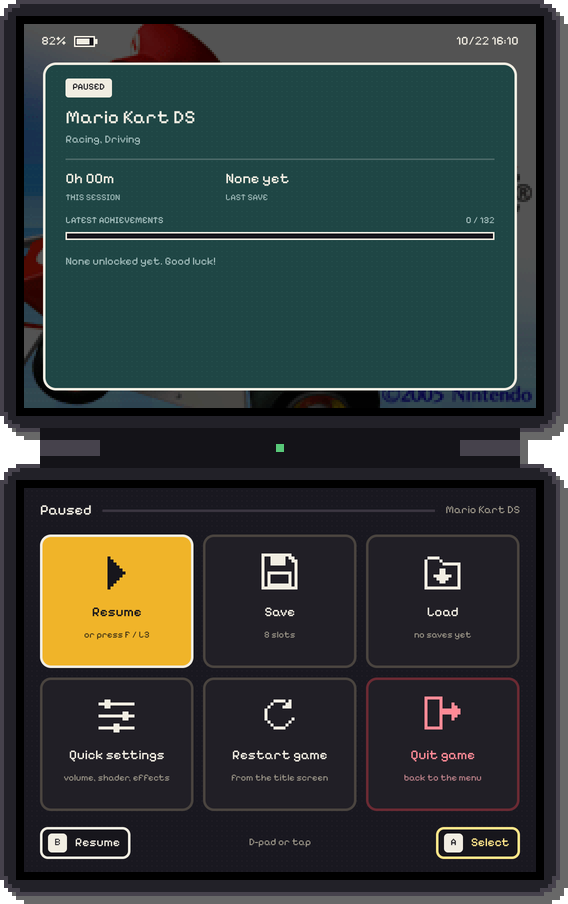<br><sub>In-game menu: save, load and adjust quick settings.</sub></td>
    <td align="center">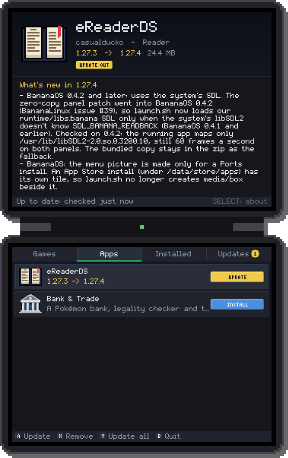<br><sub>App Store: install and update apps from the menu.</sub></td>
  </tr>
  <tr>
    <td align="center"><br><sub>Settings: six groups, with help on the top screen.</sub></td>
    <td align="center">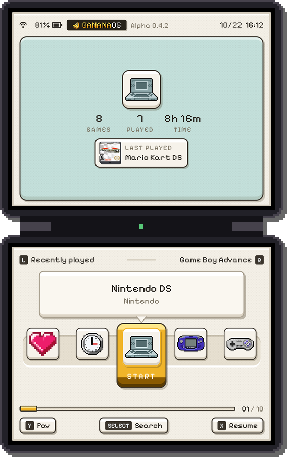<br><sub>Light theme: the same interface in a lighter palette.</sub></td>
    <td align="center">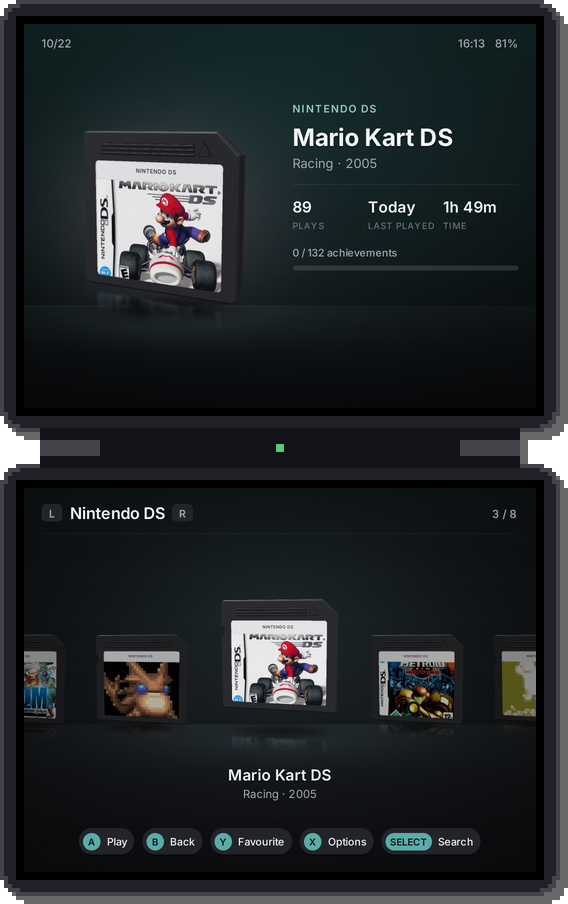<br><sub>Carts: browse your games on a 3D shelf. Experimental.</sub></td>
  </tr>
  <tr>
    <td align="center">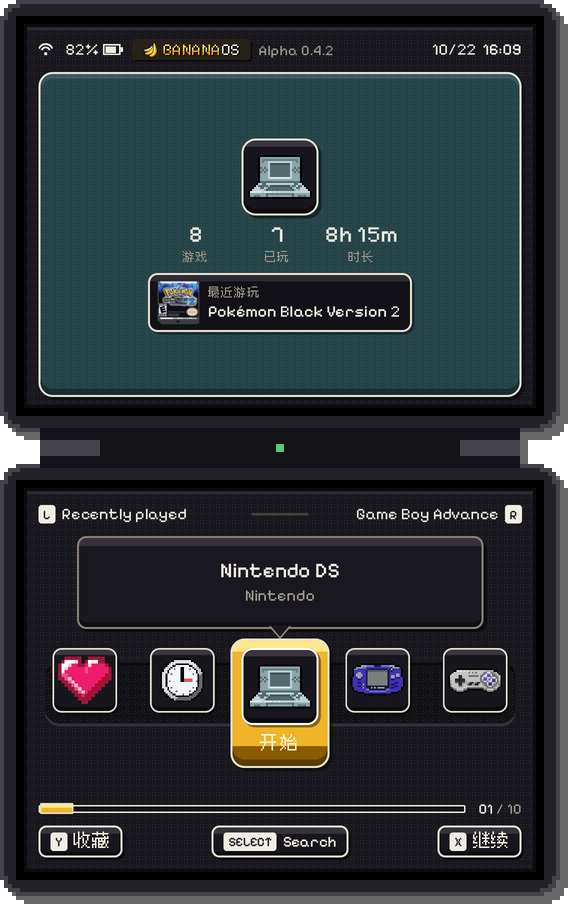<br><sub>Simplified Chinese: translation by Majirefy.</sub></td>
    <td align="center">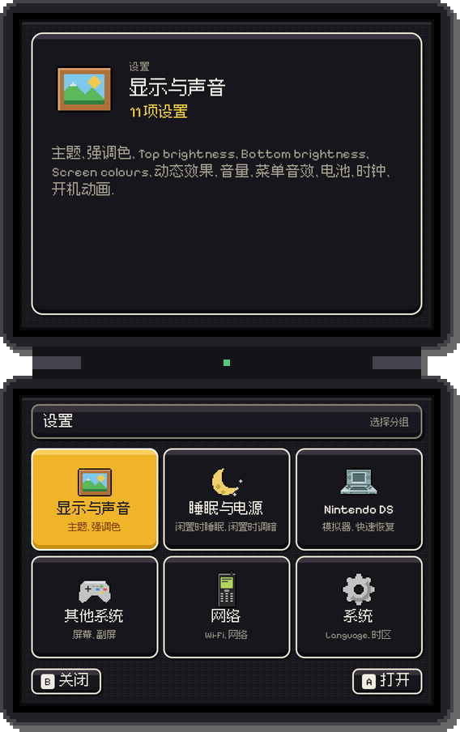<br><sub>Simplified Chinese settings.</sub></td>
    <td align="center">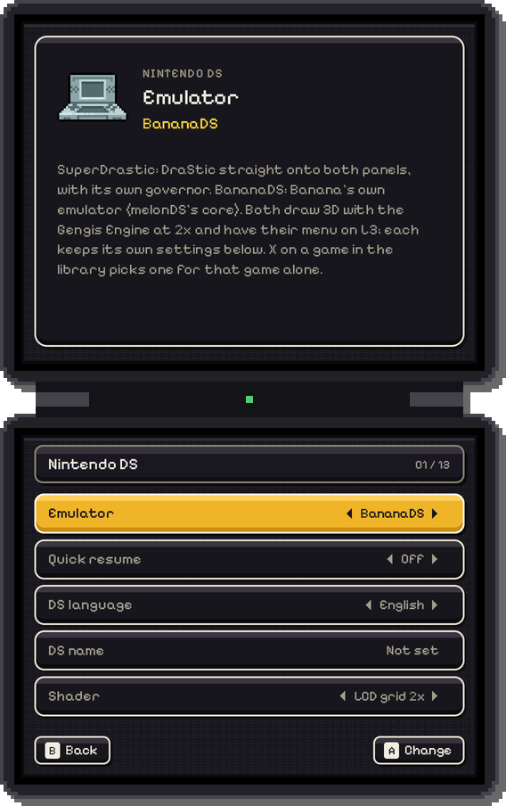 Nintendo DS: Emulator BananaDS, Quick resume, DS language, DS name, Shader LCD grid 2x"><br><sub>Nintendo DS settings: emulator, shader, DS language and name.</sub></td>
  </tr>
</table>

<p align="center">
  
</p>
<p align="center"><sub>The boot animation.</sub></p>

<a id="nintendo-ds"></a>
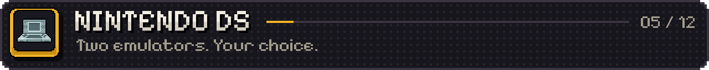

## Nintendo DS: two emulators, your choice

<p align="center">
  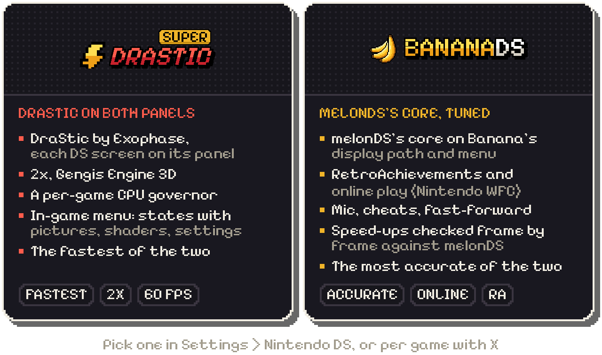
</p>

Both put each DS screen on its own display and include an in-game menu for save states, shaders and quick
settings. Choose a default in Settings > Nintendo DS, or press X in the library to choose one for a game.

| | [SuperDrastic](https://github.com/JorreFog/SuperDrastic) | BananaDS |
|---|---|---|
| Core | DraStic by Exophase, adapted for the RG DS and RG DS Plus | The melonDS core on BananaOS's display path and menu |
| 3D | Gengis Engine at 2x, threaded | Gengis Engine at 2x, threaded |
| CPU clocks | Per-game tuning | Steps down only when the heaviest frames still fit |
| RetroAchievements | No | Softcore, with the account from setup |
| Online play | No | Nintendo WFC through Kaeru |
| Microphone | A "blow" key | The real microphone |
| Extras | Shaders, save states with previews | Cheats for 4,000+ games, fast-forward (R2), FPS counter, screenshots (F + L2) |

Press F or L3 for the in-game menu. The Anbernic button also opens it. More in
[docs/EMULATORS.md](docs/EMULATORS.md), the contract between the menu and any emulator.

<a id="and-the-rest"></a>
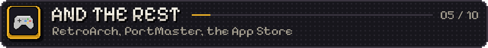

## More systems, apps and ports

- RetroArch systems: GBA, Game Boy, NES, SNES, Mega Drive, PlayStation and N64, on one screen. The other screen
  holds touch tiles for save, load, menu, fast-forward and quit. Shaders are included (Settings > Other systems >
  Shader).
- PortMaster and PICO-8: PortMaster with its ports, as on ROCKNIX; PICO-8 through fake-08, or the official PICO-8
  when it is on the card.
- App Store: install and update Döda Kvarter, Bank & Trade and eReaderDS from the menu.
- Search and artwork: search names, genres or years across every system (Select), Recently played and Favorites
  shelves, box art from libretro or [TwilightBoxart](https://boxart.kirovair.com/), and games on a second SD card on
  the RG DS Plus.
- File sharing: over Wi-Fi the card is `\\<address>\banana` (log in as `banana` / `linux`). Copied games show up in
  the menu.

| System | RetroArch core (RetroArch 1.22, built for the RK3566's Cortex-A55) |
|---|---|
| GBA | gpSP or mGBA |
| Game Boy | Gambatte |
| NES | FCEUmm |
| SNES | Snes9x |
| Mega Drive | PicoDrive |
| PlayStation | PCSX ReARMed |
| N64 | Mupen64Plus-Next |

<a id="made-for-it"></a>
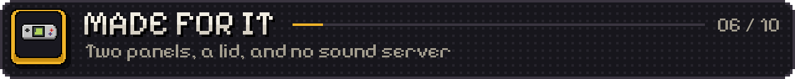

## Built for two screens and a lid

- Suspend and resume: close the lid and the game pauses, the card is flushed and the handheld sleeps. Open it and
  the game carries on. Woken in a bag, it goes back to sleep.
- Sound without setup: the speakers or headphones switch the moment headphones are plugged in, during a game too.
- Battery care: while asleep it checks the battery and shuts down cleanly before it runs flat. The LEDs work as on
  ROCKNIX: green, red at 20%, blinking red at 5%, amber while charging.

<details>
<summary>Hardware details</summary>

- Both 640x480 (RG DS) or 1024x768 (RG DS Plus) screens are driven directly, with no compositor.
- The RG DS's screens are retuned from 60.10 Hz to 60.0013 Hz in the device tree; on the RG DS Plus,
  `banana-panel-tune` reads the real pixel clock on the first boot and retunes both screens to 59.999 Hz.
- No sound server: audio goes to the RG DS Plus's AW88166 amplifiers or the headphones directly; the microphone
  records from the rk817 at full level.

</details>

<a id="status"></a>
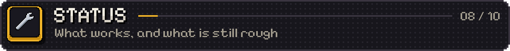

## Status and known issues

Release checks for 0.4.2: 74 device tests passed on the RG DS Plus and 62 on the RG DS, and every change was
code-reviewed before the build. These are checks of this release, not a compatibility guarantee.

Known issues:

- In Chinese, text added since the translation still shows in English (Recently played, Search and a few rows).
- Golden Sun: Dark Dawn's opening flyover runs slowly in BananaDS.
- On the RG DS Plus, a DS shader with heavy 3D can drop an occasional frame in long sessions. Setting that game's
  shader to None (X in the library) avoids it.

Not available yet:

- Charging while switched off on the RG DS Plus ([#34](https://github.com/JorreFog/BananaLinux/issues/34)).
- Bluetooth.
- One card image for both handhelds: each has its own image for now.

What's next: [docs/ROADMAP.md](docs/ROADMAP.md). Every release's notes: [Releases](https://github.com/JorreFog/BananaLinux/releases).

<a id="build"></a>
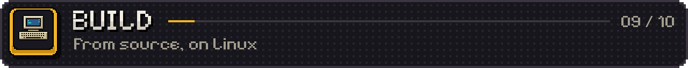

## Build

### Build from source

On Linux (Debian/Ubuntu: `build-essential bc bison flex libssl-dev libelf-dev unzip rsync cpio python3-dev swig
libgnutls28-dev`). The released 0.4.2 is the tag `v0.4.2`:

```sh
make rgds          # output/rgds/images/banana-rgds.img.gz
make rgds-plus     # output/rgds-plus/images/banana-rgds-plus.img.gz
```

The first build fetches Buildroot and everything it builds, and takes an hour or more. The whole image boots in
QEMU with no handheld (`tools/qemu-boot.sh`, also the CI's `boot` job): the first boot, the menu on two virtual
panels, a game started from the library, a shutdown from the settings.

### Work on the menu

No handheld needed:

```sh
make ui            # ui/banana-ui for this computer
make test          # renders the menu from a test library into ui/tests/out
```

| Path | What |
|---|---|
| `ui/` | `banana-ui`: the KMS host (`src/`), ROCKNIXDS Pixel's engine (`rnds/`), its assets, the headless tests |
| `system/bananad/` | `bananad` (sleep, lid, power button, LEDs, sound routing, volume and brightness, battery guard) and `banana-panel-tune` |
| `system/rootfs/` | init, first boot, `banana-perf`, sleep hooks, the game launchers, default settings |
| `buildroot/` | defconfigs, Banana's packages, the RG DS board (kernel patches, device trees, drivers, U-Boot, image layout) |
| `store/` | the App Store's catalogue |
| `tools/` | the menu engine's import, ROCKNIX's hardware sync, the pixel bunch, the logo, the boot animation, this page's pictures (`make-readme-art.py`) |
| `web/` | the website on GitHub Pages: the [Save Mover](https://jorrefog.github.io/BananaLinux/save-mover/) |
| `docs/` | [ARCHITECTURE.md](docs/ARCHITECTURE.md), [EMULATORS.md](docs/EMULATORS.md), [FIRST-BOOT.md](docs/FIRST-BOOT.md), [ROADMAP.md](docs/ROADMAP.md) |

<a id="seen-on-youtube"></a>
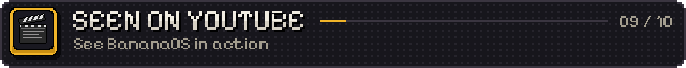

## See BananaOS in action

<table>
  <tr>
    <td align="center" width="50%">
      <a href="https://www.youtube.com/watch?v=yW6LavgyhL4&t=948s">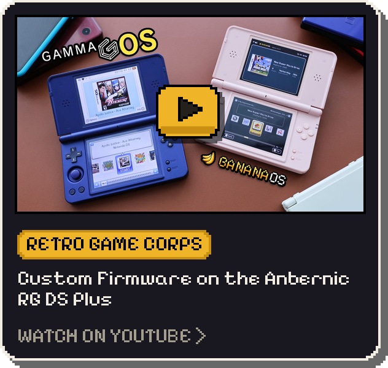</a><br>
      <sub><a href="https://www.youtube.com/@RetroGameCorps">Retro Game Corps</a>: Custom Firmware on the Anbernic RG DS Plus. BananaOS from 15:48.</sub>
    </td>
    <td align="center" width="50%">
      <a href="https://www.youtube.com/watch?v=KPENdDlkI5M">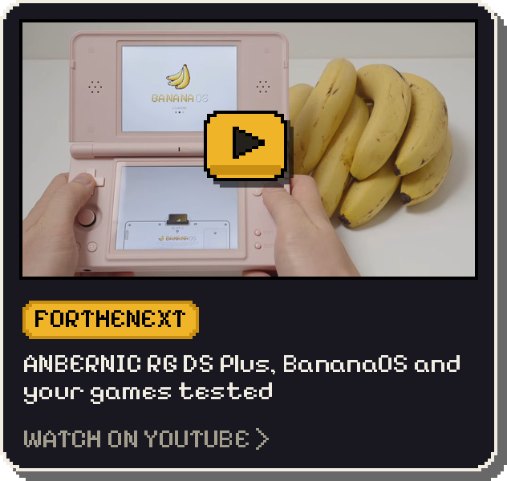</a><br>
      <sub><a href="https://www.youtube.com/@forthenext">forthenext</a>: ANBERNIC RG DS Plus, BananaOS and your games tested.</sub>
    </td>
  </tr>
</table>
<p align="center"><sub>Thank you both! Made a video about BananaOS? Tell us on <a href="https://discord.gg/3wf73cK2Qq">Discord</a>.</sub></p>

<a id="credits"></a>
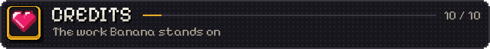

## Built on community work
- Simplified Chinese (简体中文): translated by Majirefy. The characters are drawn with
  [Fusion Pixel Font](https://github.com/TakWolf/fusion-pixel-font) (缝合像素字体) by TakWolf. To translate BananaOS
  into your language, ask for the translation document; `tools/lang-from-docx.py` turns a filled-in one into
  `ui/assets/lang/<language>.tsv`.
- jesussaves-ai: the [BananaLinux Flasher](https://github.com/jesussaves-ai/banana-linux-flasher), the card writer for Windows, Linux and macOS, and in BananaOS the PS1 game panel, the game panel's idle dimming, the microphone routing and the Reset rows.
- casualducko: the zero-copy panel patch for LÖVE apps on both panels (eReaderDS).
- swouapiy: the shutdown animation (the boot animation backwards).
- The Pokémon companion on RetroArch's game panel is inspired by [PokeDaisy](https://github.com/lidor30/pokedaisy)
  by Lidor Itzhari (lidor30), the companion app for Android handhelds with two screens. BananaOS's is its own code,
  written from the games' documented data.
- The menu is ROCKNIXDS Pixel, from [ROCKNIXDS](https://github.com/JorreFog/ROCKNIXDS), where BananaOS started.
  Banana's mark is the bunch of [BananaUI](https://github.com/JorreFog/helios), redrawn as pixel art.
- The RG DS's kernel support, device trees and drivers come from [ROCKNIX](https://rocknix.org). DS emulation is
  DraStic by Exophase (through [SuperDrastic](https://github.com/JorreFog/SuperDrastic)) and
  [melonDS](https://melonds.kuribo64.net/)'s core (BananaDS).
- [Retro Game Corps](https://www.youtube.com/@RetroGameCorps) and [forthenext](https://www.youtube.com/@forthenext)
  for showing BananaOS to a lot of people.

### Development and AI

Much of the code, tests and documentation was developed with Claude as a coding assistant. The maintainer directs,
reviews and tests the work on real hardware. Bug reports and contributions are welcome.

### Licenses

BananaOS is MIT licensed ([LICENSE](LICENSE)); bundled components keep their own licenses, listed in
[THIRD_PARTY.md](THIRD_PARTY.md). BananaOS contains no games, ROMs or BIOS files.

<p align="center"><a href="https://discord.gg/3wf73cK2Qq"><b>Questions, reports, setups: join the Discord</b></a></p>
