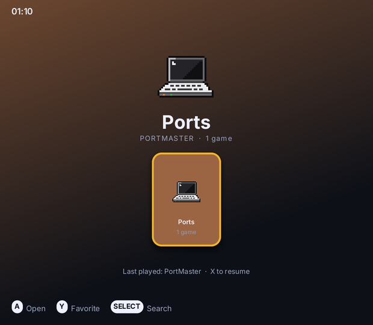
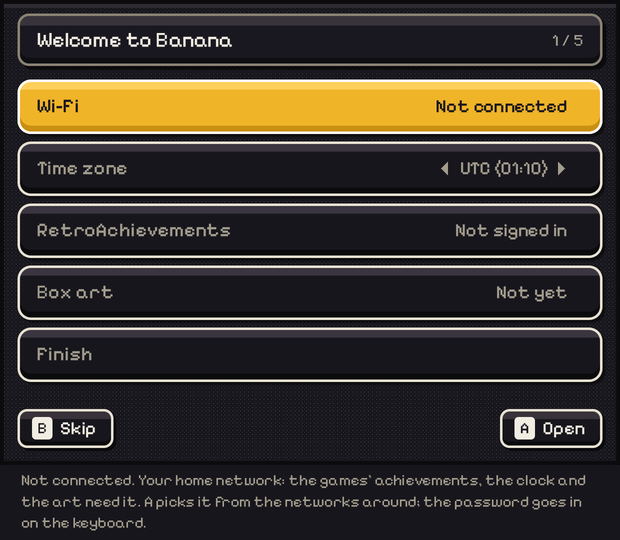
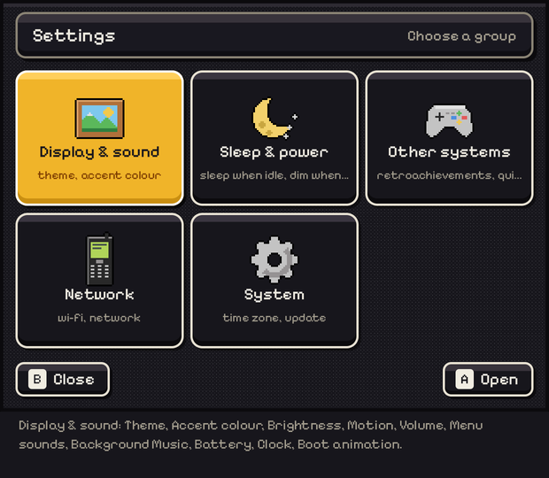
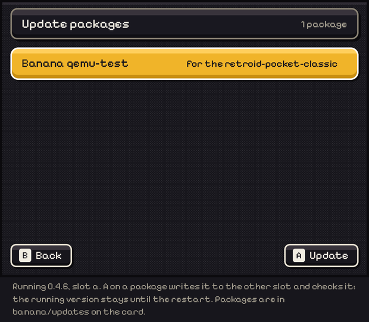
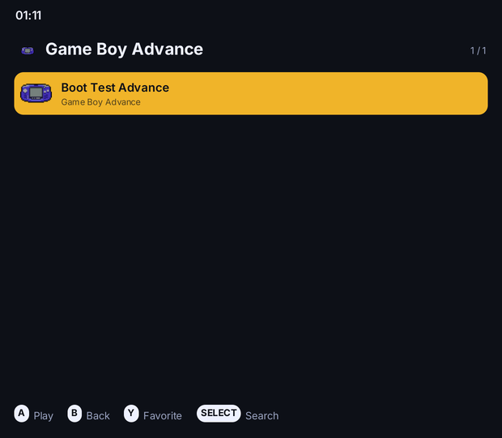

# Banana Pocket

Banana for the **Retroid Pocket Classic** (Qualcomm Snapdragon G1 Gen 2 / SM4450): a read-only squashfs
root, an exFAT data partition, a Pixel UI drawn on the CPU, and no systemd, no compositor and no sound
server. It boots from two A/B root slots, so an update never touches the running system.

This repository is **early access**. It is a work in progress, built from source, and tested in QEMU on
every image the CI produces. The hardware is real: the panel timings, the AW88166 amplifiers' PLL, the
Qualcomm AudioReach DSP graph and the power/sleep behaviour are all measured on the handheld.

## Screenshots

All of these are the 1240×1080 panel in QEMU, taken by the boot test (`tools/qemu-boot.sh`).

| | |
|---|---|
|  | the menu, after the library scan |
|  | the first-time setup: Wi-Fi, time zone, RetroAchievements, ScreenScraper |
|  | Settings (Start): theme, brightness, sleep, Wi-Fi |
|  | System > Update: the package, written to the other slot |
|  | a GBA game running through RetroArch on the panel |

## What it runs

| Part | What |
|---|---|
| `banana-ui` | the menu: a ROCKNIXDS Pixel frontend with a software Backend, KMS dumb buffers, inotify-watched ROM folders |
| `bananad` | the daemon: input, sleep, battery, LEDs, the sound route, the clock, Wi-Fi and the RTC alarm |
| `banana-perf` | the clock profiles: `ui`, `powersave`, `balanced`, `performance` |
| RetroArch + cores | the emulators, launched from the library with the menu's settings |

The kernel is built from ROCKNIX's SM4450 support, trimmed to what the device tree has: no HDMI,
no cameras, no Bluetooth, no FUSE, no swap, no netsched. The modules that remain are the Wi-Fi and GPU ones,
the AudioReach audio stack, the fan, file sharing and virtio for QEMU.

## Building it

Buildroot does everything: the toolchain, the kernel, Mesa/freedreno, RetroArch and the cores, the
squashfs root and the SD card image.

```sh
make retroid-pocket-classic
```

This produces `output/retroid-pocket-classic/images/banana-retroid-pocket-classic.img.gz` and its update
package. It takes an hour or more on a fast machine; the CI caches downloads and the compiler cache
between runs.

### Running it in QEMU

The whole system boots in QEMU's `virt` machine with the card on a PCI SDHCI, a 1240×1080 virtio panel
and a serial console. The boot test drives the menu through the first boot, a game, an A/B update and a
shutdown:

```sh
sh tools/qemu-boot.sh output/retroid-pocket-classic/images/banana-retroid-pocket-classic.img.gz qemu-out
```

Screenshots and logs land in `qemu-out/`. For a window with the panel, use `--interactive`.

### Running it on the handheld

Flash the image to a microSD card (the first three partitions; the data partition is made on first boot):

```sh
zcat banana-retroid-pocket-classic.img.gz | sudo dd of=/dev/mmcblk0 bs=4M status=progress
```

Boot it. On first boot the menu opens a five-step setup (Wi-Fi, time zone, RetroAchievements,
ScreenScraper, Finish); **B** skips it and writes `banana/setup-done` on the card.

Updates land in `Settings > System > Update` when a `banana-<board>-<version>.update.tar` is copied to
`banana/updates/` on the card (file sharing, or `ssh "cat > /data/banana/updates/..."`). The package is
checked hash by hash, written to the slot not in use, and the running system is never touched:
`Previous version` switches back.

## Layout

```
ui/                banana-ui: the menu (rnds engine, soft Backend, kms Display, settings, Worker)
system/bananad/    the daemon and its sleep test
system/rootfs/     the root filesystem: init, rcS, the launchers, the sleep.d hooks
buildroot/         Buildroot external: the board, the kernel fragment, the defconfig
buildroot/board/retroid-pocket-classic/   device trees, panel, kernel patches, firmware, OpenABL
tools/             qemu-boot.sh, the import script, the benchmark
docs/              the architecture, the roadmap, the hardware notes
```

## Measured

In the VM, idle in the menu: the menu draws only when something changes and sleeps in `poll()` otherwise;
bananad wakes about once a minute. `tools/qemu-boot.sh` reports the memory, each program's own, and the CPUs'
idle share from inside the VM. The menu's own CPU cost, headless on a PC, is in `docs/PERFORMANCE.md` (`make
bench`).

## License

See `LICENSE`. The `ui/rnds` engine is imported unchanged from ROCKNIXDS.