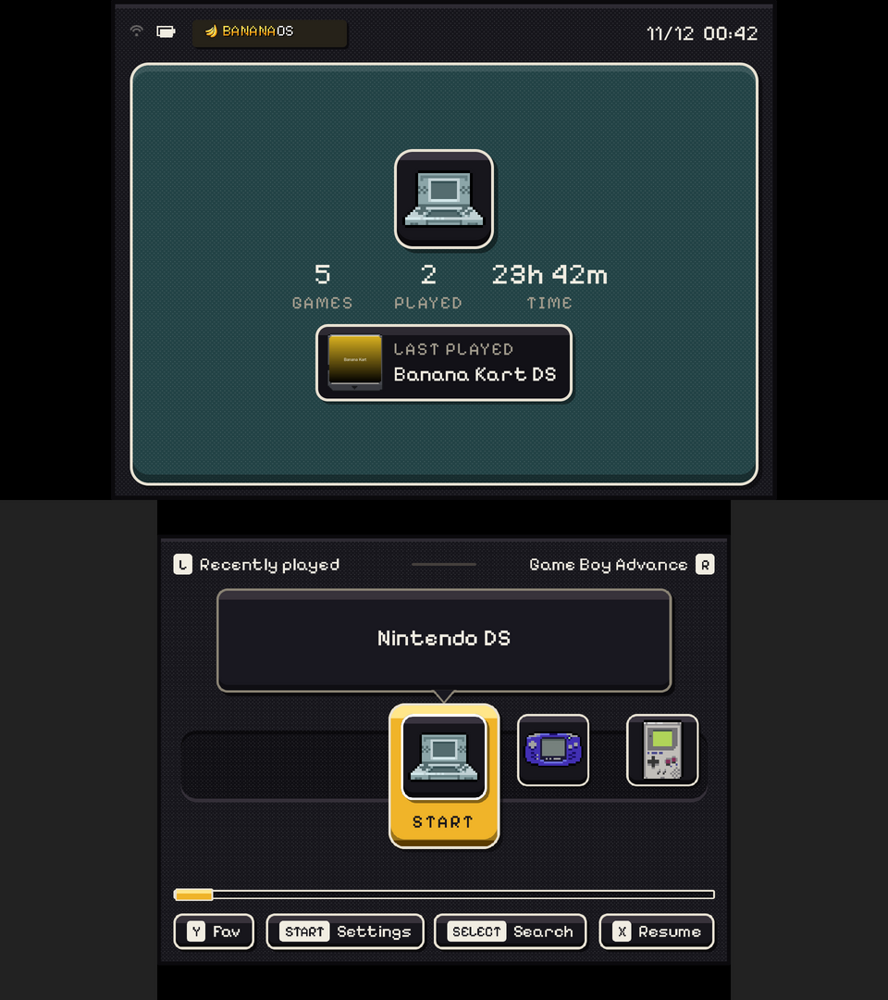

# BananaOS on the AYN Thor

> **The direction changed on 2026-11-12.** The Thor version is ROCKNIX's image with BananaOS's dual-screen menu as
> its frontend: see [`docs/THOR-ROCKNIX.md`](THOR-ROCKNIX.md). This page is the BananaOS-on-Buildroot board that came
> first (`make thor`). It stays as reference and as a fallback, and its hardware findings hold either way.

The plan, and where it stands, for BananaOS on the AYN Thor (Snapdragon 8 Gen 2, SM8550: the Base, Pro and Max).
The Thor Lite is a different handheld (Snapdragon 865, SM8250) and isn't covered here.

**Status: in bring-up.** It builds as `make thor`, but no image has been booted on a Thor yet. Lines marked *(check)*
come from ROCKNIX's device tree and haven't been seen on a running Thor. M1 below settles them.

## The approach: the RG DS's system, the Thor's hardware

BananaOS is a few small pieces that sit on top of a hardware layer:

- the menu (`banana-ui`)
- the daemon (`bananad`)
- the launchers, the emulators and the update (`system/`, `buildroot/package`)

On the RG DS that hardware layer comes from ROCKNIX's RK3566 work (`tools/sync-rocknix-hw.sh`). The Thor gets its
hardware layer the same way, from ROCKNIX's SM8550 work (`tools/sync-rocknix-sm8550.sh`), and keeps everything else:

| | RG DS / RG DS Plus | AYN Thor | Shared? |
|---|---|---|---|
| SoC, GPU | RK3568, Mali-G52 (Panfrost, `package/mesa3d-panfrost`) | SM8550, Adreno 740 (freedreno, Buildroot's `mesa3d`) | no |
| Kernel | 7.2.7 + ROCKNIX RK3566 patches (`board/rgds`) | 7.2 + ROCKNIX SM8550 patches (`board/thor`, 71 patches) | Banana's fragment (`board/rgds/linux-banana.fragment`) on both |
| Bootloader | U-Boot at sector 64 of the card | OpenABL on the Thor's `abl_a`/`abl_b`, flashed once (`package/openabl`) | no |
| Card layout | boot FAT, `banana-root-a`/`-b`, data exFAT | the same partitions, no bootloader area | rcS, firstboot, update unchanged |
| Boot entry | `extlinux.conf`, `DEFAULT` = slot | `extlinux.conf` plus a BLS entry (`loader/entries/banana.conf`), both switched by `update` | update script |
| Panels | 2× 640x480 or 2× 1024x768, upright | 1080x1920 top, 1080x1240 bottom, both portrait panels mounted turned 90° | banana-ui: a 1440x1080 canvas fitted per panel (`ui/src/panelfit.*`) |
| Pad | ADC joypad (`retrogame_joypad`) | RSInput MCU on uart15 ("AYN Odin2 Gamepad", analog triggers) | evdev in banana-ui and bananad (by capability) |
| Touch | Goodix (bottom; both on the RG DS) | FocalTech FT5426 (top), FT5452 (bottom) | banana-ui (by `BANANA_TOUCH`) |
| Sound | RK817 codec + AW87391 / AW88166 | WCD9385 + 2× AW88166 through the ADSP (audioreach) | bananad's mixer setup needs a Thor path |
| Wi-Fi / BT | RTL8821CS (rtw88, hci_uart H5) | WCN7850 (ath12k on PCIe, hci_uart QCA) | `wifi`, `bluetooth` scripts mostly |
| Lid | Hall sensor, `SW_LID` | Hall sensor on gpio17, `SW_LID` | bananad |
| Fan, LEDs, rumble | none; power LED | pwm-fan; RGB rings round the sticks (HTR3212); PMIC haptics | new for Banana |
| Firmware | rtw88, aw88166_acf | Adreno zap, GMU and microcode, ADSP and CDSP, topology, WCN7850 | `package/thor-gpu-firmware` (the Adreno 740's three, from linux-firmware 20260622: Buildroot's release has none of them) and `package/rocknix-extra-firmware` (the Thor's at a later commit than the RG DS's, for its sound topology) |

Two more things come from the same layering:

- **The hardware profile.** Every board now has `system/rootfs/etc/banana/hw/<board>.conf`. post-build installs it as
  `/etc/banana/hw.conf`, and rcS reads it through `usr/libexec/banana/hw-env`. It holds:
  - the top panel's connector
  - the touchscreen
  - the panels' mounting
  - the backlights
  - the modules to load
  - the Wi-Fi module to unload around sleep

  It replaces RG DS values that were written into the scripts. The RG DS's profile reproduces exactly what was
  there before.
- **`usr/libexec/banana/hw-probe`**. It runs on any board and writes a report of everything the kernel sees: DRM
  connectors and modes, input devices, ALSA cards and controls, power supplies, LEDs, remote processors, firmware
  requests and errors. Its output on a Thor answers every *(check)*.

## Done in this branch

- `buildroot/configs/banana_thor_defconfig`: the RG DS build option for option, with the hardware swapped. CI's
  "keeps every option" check now covers it too.
- `buildroot/board/thor/`:
  - ROCKNIX's SM8550 kernel config, 71 patches and the Thor's device tree, pinned in `ROCKNIX` (commit `6cf94dba`)
  - `linux-thor.fragment`
  - the image layout (`genimage.cfg.in`, `extlinux.conf.in`, `banana.conf.in`)
  - `post-image.sh`
  - the OpenABL flashing note
- Checked off the hardware, without a Thor:
  - all 71 patches apply to Linux 7.2 as `external.mk` applies them
  - ROCKNIX's config with Banana's fragment and the Thor's merges with every Thor option kept (`CONFIG_EXPERT` added
    so the VTs can go)
  - `qcs8550-ayn-thor.dtb` compiles
- `buildroot/external.mk`:
  - the RG DS's kernel drivers, device trees and patches go into an RG DS kernel only (`BANANA_BOARD`)
  - the Thor's device trees go into the kernel's `qcom` directory
  - the Adreno and WCN7850 firmware the Buildroot options miss
- `package/openabl` (v1.2, ROCKNIX's pin) and `package/rocknix-extra-firmware` (the Thor's files, from the same
  commit as the RG DS Plus's).
- **banana-ui on panels that differ**. Before, `kms.cpp` refused to start ("the two panels have different modes").
  Now:
  - The menu draws one canvas: the panels' own size on the RG DS (unchanged), 4:3 elsewhere (1440x1080 on the Thor).
  - Each panel shows that canvas scaled to fit, centred and turned by the kernel's panel orientation (or
    `BANANA_PANEL_ROTATE`).
  - Touches go back through the same fit, whichever way the touchscreen reports.
  - `ui/tests/panelfit-test.cpp` covers the Thor's geometry, every rotation, partial redraws and touches.
- The runtime reads the profile:
  - rcS's modules
  - the Wi-Fi sleep hook
  - bananad's and Settings' backlight names
  - `update list` for `banana-thor-*` packages
  - the BLS entry switched with `extlinux.conf`, tested in `ui/tests/update-apply.sh`
- `make thor`, `tools/sync-rocknix-sm8550.sh`, `hw-probe`, and Claude Code skills for this work in `.claude/skills/`.

## Milestones

Each milestone ends with something you can check on the handheld.

### M0: it boots (needs a Thor)

1. `make thor`, then write the card. Flash OpenABL (`openabl/README.txt` on the card's boot partition). **Back up the
   ABL first.**
2. Settle how OpenABL reads the card. Banana Pocket (below) boots the same way on its SM4450 handheld: OpenABL reads
   `extlinux/extlinux.conf` and its per-slot `LINUX` and `FDT` lines, a plain `Image`, no BLS entry. Expect the same
   here. If so, the BLS entry and `dtbs/` are spares; drop them once the Thor confirms it. The update switches both
   either way.
3. Expected first problems:
   - The root on the card. The SD card should be `mmcblk0`, with the UFS as `sd*`. rcS and update look for
     `PARTNAME=banana-root-a`, so check that.
   - The firmware path for the ADSP, which ROCKNIX loads from `/lib/firmware/qcom/sm8550/ayn/thor/`.
4. Done when: the boot reaches rcS, and SSH (Settings › Network, or a USB Ethernet adapter, which DHCP brings up)
   gives a shell (SSH: Settings › Network › File sharing › SSH, a public key in `banana/ssh/authorized_keys`).

### M1: the facts (needs M0)

1. Run `/usr/libexec/banana/hw-probe` and commit its report under `docs/thor/` for reference.
2. Fix `etc/banana/hw/thor.conf` from it:
   - the connector names (is the top `DSI-2`?)
   - the bottom touchscreen's sysfs path
   - the panels' "panel orientation" (expected `Right Side Up`, which banana-ui turns 90°)
   - the backlight names (AMOLED panels: the DSI panels' own backlight devices)
   - the Wi-Fi module
3. Done when: every *(check)* in `thor.conf` and on this page is gone.

### M2: the menu (needs M1)

1. banana-ui on both panels: right way up, touch landing where it's pressed, the pad driving the menu. The RSInput
   pad reports `BTN_SOUTH`/`EAST`/...; check A/B against the label (the RG DS's A is east, `input.cpp`).
2. `banana-ui --panels-on` at boot. The Thor's AMOLEDs have their own power-up time, so measure it.
3. 120 Hz top panel: the menu paces itself by flips. Decide between 60 Hz (`video=DSI-2:...@60`) and 120 Hz.
4. The scanout copy is software. Measure it with `BANANA_FRAME_STATS`. The canvas fit is nearest-neighbour on the CPU.
   If it shows up, move to the DPU's plane scaling (atomic `SRC`/`CRTC` rectangles) and its inline rotation (ROCKNIX's
   0066 patch).
5. Done when: home, library, settings and the game ready screen work by pad and by touch on both screens.

### M3: power, sound, network (needs M2)

1. **Sound.**
   - bananad finds cards by name (`aw88166`, `rk817` in `/proc/asound/cards`).
   - The Thor runs ROCKNIX's sound stack:
     - udev loads the drivers (`HW_DEVMGR=udev`).
     - PipeWire and WirePlumber run the card from ROCKNIX's UCM profile (`HW_SOUND=pipewire`,
       `usr/libexec/banana/sound-server`). The profile comes from `package/alsa-ucm-conf` with
       `patches/alsa-ucm-conf/0001-Add-AYN-Thor.patch`.
     - bananad's server mode points `default` at PipeWire, and the volume script uses `wpctl`.
     - PipeWire's Bluetooth plugin replaces bluez-alsa.
   - ROCKNIX ships no PipeWire patches and no WirePlumber config for the Thor, so start with these stock.
   - Check:
     - the speaker, and the jack switching over
     - the microphone
     - the volume keys
     - Bluetooth headphones
     - the 20 s Banana Pocket saw before the first sound (its kernel fixes are in)
   - If the DSP drops a route once a stream is open, take Banana Pocket's PipeWire patch 0002, which re-applies the
     UCM verb before the open.
2. **Battery.** The charger and gauge are the ADSP's battery manager (`battmgr.jsn`), not the RK817. bananad finds
   power supplies by type. Check the "Discharging while charging" quirk, which is the RK817's only.
3. **Sleep.**
   - ROCKNIX lists "fake suspend" only for SM8550.
   - Start with bananad's display-off idle: panels off, CPUs held low, the game paused. Treat real `mem` sleep as
     research: `/sys/power/mem_sleep`, the ipcc wakeup patch 0502.
   - Banana Pocket's notes on the same mainline stack (its `docs/RPC-PORT.md`):
     - `mem` sleep held from a shell, but woke after ~2 s from bananad's power-key path.
     - No RTC wake alarm (the ADSP owns it), so bananad's timed battery check can't wake the handheld.
     - A VT switch on suspend wedged it until `SEATD_VTBOUND=0`.
     - Its SoundWire patch 0039 is a lead (`board/thor/linux-patches-banana/README.md`).
   - The lid is `SW_LID` as on the RG DS.
4. **Wi-Fi.** ath12k with `wpa_supplicant`, interface `wlan0` (check). Does it need to be unloaded around sleep?
   (`HW_WIFI_MODULE`, empty for now)
5. **Bluetooth.** The `bluetooth` script assumes the RTL8821CS on uart1 through hci_uart H5. The WCN7850 is QCA on
   uart14 (`qca/hmtbtfw20.tlv`). Make the script's chip setup a profile value.
6. **Fan.** pwm-fan with the device tree's thermal trips. It's built in and works without help. Expose a fan curve
   later.
7. Done when: a day's use has sound, charging, the lid and Wi-Fi working, and the battery reads right.

### M4: games (needs M3)

1. **GPU.**
   - freedreno GLES: RetroArch, SuperDrastic's shaders, BananaFront.
   - Turnip (Vulkan) is in the image now, from Banana Pocket's Buildroot patches (`buildroot/buildroot-patches`:
     the option, and Mesa 26.2.6). The Makefile applies them to Buildroot. Use it for PPSSPP, Dolphin and the like.
2. **CPU.**
   - Builds are for the Cortex-A710 (`BR2_cortex_a710`) with SVE off (`external.mk`: the Snapdragon 8 Gen 2 has no
     SVE, and GCC emits it for `-mcpu=cortex-a710` at `-O2`). BananaDS and BananaFront follow the board's CPU.
   - `banana-perf` caps `policy0` at RK3568 clocks. The Thor has three policies (A510, A715/A710, X3); give each
     profile per-policy caps.
3. **The panels in games.** The DS emulators, the SDL2 panels patch and RetroArch's monitor index all address the
   panels by connector. They each take the panel's own mode. Check each one draws the right size on the 1080x1920 and
   1080x1240 portrait panels: they'll need the same turn the menu does, or the DPU's rotation.
4. **Pad mapping.**
   - `retrogame_joypad.cfg` is named after the RG DS's pad. Add RetroArch's autoconfig for "AYN Odin2 Gamepad"
     (2020:3001).
   - Map DraStic's buttons from ROCKNIX's SM8550 `drastic.cfg`.
   - `nds-buttons` and the analog triggers on `ABS_Z`/`ABS_RZ`.
5. Done when: a DS, GBA and PS1 game each play with sound, save and resume.

### M5: release (needs M4)

1. Add `thor` to the CI image matrix.
2. Write a README section, and a known-issues list from the QA pass.
3. Re-test the RG DS images: post-build's profile and external.mk's board switch touch their build too.
4. Done when: a `banana-thor-<version>.update.tar` installs through Settings › System › Update on a Thor.

## From Banana Pocket

[Banana Pocket](https://github.com/jesussaves-dev/Banana-Pocket) is BananaOS for the Retroid Pocket Classic
(SM4450, MIT, the Banana contributors). It went down the same road first: ROCKNIX's Qualcomm kernel, OpenABL, the
same card and update. Taken from it at `2f4da8bf`:

| What | Where here | Checked |
|---|---|---|
| Turnip option and Mesa 26.2.6 for Buildroot, and the Makefile step that applies Buildroot patches | `buildroot/buildroot-patches/`, `Makefile` (`buildroot-patched`), CI | apply to Buildroot 2026.02.3, idempotent; the Mesa hash; all four defconfigs keep every option |
| `alsa-ucm-conf` package (ROCKNIX's Thor profile goes on top) | `buildroot/package/alsa-ucm-conf`, `buildroot/patches/alsa-ucm-conf` | the Thor profile applies to 1.2.16.1 and every file it includes is there |
| 8 kernel patches: GENI UART RX restart (the pad), AW88166 start/format fixes (the ~20 s silent boot), battery manager, q6apm timing | `buildroot/board/thor/linux-patches-banana` (its README says which, and which were left out and why) | apply after ROCKNIX's 71; the drivers build for arm64 with the Thor's config |
| The sound server's start and its sleep hook (simpler here: with real udev, its probe-retry workarounds and its libudev-zero patches aren't needed) | `usr/libexec/banana/sound-server`, `etc/banana/sleep.d/20-sound` | scripts parse; bananad's server mode builds |

**Worth taking later:**
- **The PipeWire sound server**, if the Thor's DSP needs it (M3).
- **Its QEMU fragment for a Qualcomm kernel** (`linux-qemu.fragment`). It boots the board's own kernel on `virt` for
  CI, which would let CI boot `make thor` the way it boots the RG DS image.
- **USB gadget, ADB and mass-storage scripts.**
- **Its docs.** `docs/BOOT-SOUND.md` and `docs/RPC-PORT.md` cover the sound and sleep it already worked out on this
  stack.

**The Thor uses the standard pieces where the RG DS has minimal ones.** It has eight cores and 8-16 GB, so it runs
what ROCKNIX runs on it: udev instead of devtmpfs alone, PipeWire and WirePlumber instead of bananad's own ALSA
routing, and PipeWire's Bluetooth instead of bluez-alsa. RetroArch links the real libudev where there is one. The RG
DS's profile leaves all of this off, so its image is unchanged.

## RG DS code paths still to make board-aware

From the survey of the tree; each one is cheap once M1 has the facts:

- **Board name.**
  - `settings.cpp` and `speaker_eq.cpp` assume `rgds`/`rgds-plus`: the About page and the EQ profile.
  - `bshare.cpp:218` derives the model shown to other devices.
  - `sync.cpp` and `run-retroarch:151` read `/proc/device-tree/model` for "Plus".
- **Panel sizes.**
  - `splash.cpp` picks 640 or 1024 assets by width. 1440 gets the 1024 set, scaled.
  - borders exist for `640x480`/`1024x768` (`tools/make-borders.py`): add `1440x1080`.
  - `run-ps1`, `run-gw` and `run-bank` read the first `card0-*` mode.
  - `nds/overlay.cpp` has the panels' millimetres.
- **Rockchip-only tools.**
  - `panel-tune` and `banana-panel-tune` (generic-DSI timings, VOP clocks)
  - `one-panel` (Rockchip DSI addresses)
  - `kms.cpp`'s VOP interrupt-storm check (harmless: it finds no `fe040000.vop`)
  - `run-drastic`'s refresh from `dclk_vop*`
- **Hard-coded device paths.** `/dev/dri/card0` in `sdl2/0001-banana-panels.patch` and `ui/src/leaseshim.c`. On the
  Thor the msm card should be `card0` too *(check)*.
- **Sleep tests.** `system/bananad/tests` fake the RG DS's `/sys`. Add a Thor fixture once `hw-probe` has the real
  one.

## Risks

- **OpenABL replaces the Thor's bootloader.** It has to be flashed with the ABL backed up. Settle whether flashing
  needs root or fastboot on a stock Thor before announcing anything.
- **No real sleep yet** (ROCKNIX: fake suspend). The lid and battery story will be weaker than the RG DS's until
  that's solved.
- **The pinned ROCKNIX commit moves fast** on SM8550. Re-sync with `tools/sync-rocknix-sm8550.sh <commit>`, then
  re-run the checks in `.claude/skills/rocknix-sync`.

## Sources

- ROCKNIX `distribution` at `6cf94dba` (`projects/ROCKNIX/devices/SM8550`: `options`, `linux/`, `patches/linux/`,
  `config/kernel-firmware.dat`, `bootloader/update.sh`; `packages/linux/package.mk`; `packages/tools/openabl`)
- ROCKNIX `extra-firmware` at `925dfb5e` (`SM8550/`)
- https://rocknix.org/devices/ayn/thor-sm8550 and https://github.com/OpenHandheldCollective/OpenABL
