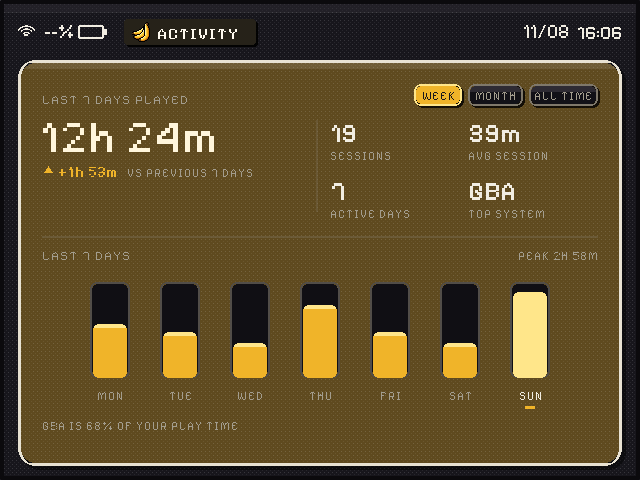
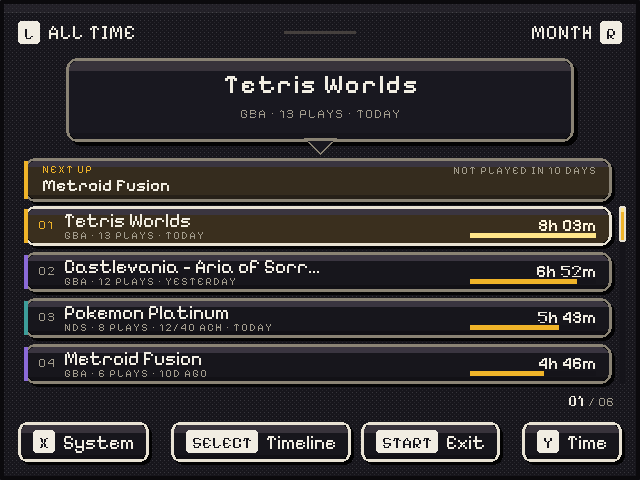

# Activity

A player-activity app for BananaOS. It reads the menu's play counts and play time, records a
session history of its own, and draws all of it in the menu's look: the tinted sheet, banded
panels, the 4x4 dither tile, Pixelify Sans and the accent from `settings.conf`.




The screenshots in `mockups/app-*.png` are rendered by the app itself (`--smoke`, no device
needed). `mockups/00-overview.png` is the design study they were built from.

## Three views

| View | Top screen | Bottom screen |
|---|---|---|
| **LIBRARY** | total time for the period, change vs the previous one, sessions / average / active days / top system, a 7-day bar chart, and one insight line | the game list, with **NEXT UP** above it |
| **TIMELINE** | one day: weekday and date, its sessions, the hour-by-hour strip and the time-of-day habit | that day's session log, with its time, system and length |
| **TRENDS** | all-time totals, an 18-week heatmap (each square is a day), and the share of time by system | the same share as a table |

**NEXT UP** is the app's "what should I play next": it scores games you have invested in but
not touched lately (`days since last play + time invested + a bonus for games you stopped
early`), and shows the best one with the reason ("You stopped after 2 plays"). `Y` → `Next`
sorts the whole list by that score.

The menu's RetroAchievements counts are kept too: a game with data shows `12/40 ACH` in its
row and in the bubble. (The previous build had a dedicated achievements block; here they sit
with the game they belong to.)

The **insight line** is generated locally from the numbers, first match wins:

- `NDS IS 54% OF YOUR PLAY TIME` (one system dominates)
- `YOU PLAY MOST AT NIGHT (48%)` (0–6 h)
- `POKÉMON PLATINUM TAKES 28% OF YOUR TIME`
- `3-DAY PLAY STREAK · 12 SESSIONS`
- `YOUR SESSIONS RUN LONG: 52M EACH`
- `3 GAMES UNTOUCHED FOR A MONTH`
- otherwise `12 SESSIONS · 6H 40M IN THIS WEEK`

## Controls

| | |
|---|---|
| **L / R** | previous / next period: week (last 7 days) → month (last 30) → all time |
| **LEFT / RIGHT** (timeline) | previous / next day |
| **UP / DOWN** | move through the list |
| **X** | filter by system (library and timeline); cycles all systems that have plays |
| **Y** | sort: Library `Time → Plays → Last → Next`; Trends `Time → Name` |
| **SELECT** | next view: Library → Timeline → Trends |
| **A** | re-read `playstats.tsv` and record any play made since (and refresh the clock) |
| **B** | back to the Library from Timeline or Trends |
| **START** | exit |
| touch | rows, the NEXT UP card, the footer buttons, the period shoulders, the day arrows |

The bottom screen is the touch panel; the top one only shows.

## What it reads and writes

Read (never written):

- `/data/banana/playstats.tsv` — the menu's per-game `plays`, `seconds`, `last` play, and
  RetroAchievements progress. This is the only other app's file it touches.
- `/data/banana/settings.conf` — `accent` (the five-shade palette) and `timezone` (a POSIX TZ
  rule; the app sets `TZ` for itself, since it is not the menu).
- `/sys/class/power_supply/*/{capacity,status}` — the battery; `/sys/class/net/*/operstate` —
  the Wi-Fi icon.

Written (its own folder only):

```
/data/banana/activity/sessions.tsv    the session history
/data/banana/activity/snapshot.tsv    the playstats values last seen
/data/banana/activity/activity.log    what it did (small, appended)
```

Both data files start with a schema line and are written atomically (a temp file, `fsync`,
then `rename`), so a power cut cannot leave a half-written history. A file with another
format is never overwritten: it is set aside as `sessions.unread-<epoch>.tsv` and the app
starts a fresh one.

### How a session is recorded

The menu only keeps totals, so Activity watches for the difference between `playstats.tsv` and
its own snapshot at every launch:

- +1 play and +N seconds → one session of N seconds ending at the game's `last` play;
- +k plays (the app was not opened for a while) → k sessions of N/k seconds;
- the first run only seeds the snapshot: **no history is invented** (sessions start then);
- a counter that goes backwards is logged and ignored, never recorded as a negative session;
- a launch that sees no new play writes nothing at all.

There is no retention/pruning: the history is the user's and grows by a few dozen bytes a day.

The legacy files from the previous Activity build (`/data/banana/activity_log.tsv`,
`activity_snapshot.tsv`) are **not** read and **not** modified. Their format is not known to this
build; if you want that history imported, send me a few of its lines.

## Build

The app is one C++17 file plus a baked font atlas, with **no runtime dependencies** (no
FreeType, no libdrm, no SDL): the aarch64 binary is static.

With the cross toolchain:

```sh
make                     # banana-activity (aarch64-linux-gnu-g++, -static -s)
```

With [zig](https://ziglang.org) (what built the included binary, 0.14.1):

```sh
zig c++ -target aarch64-linux-musl -std=c++17 -O2 -static -s -o banana-activity banana-activity.cpp
```

A host build, only for rendering previews on a computer:

```sh
zig c++ -std=c++17 -O2 -o activity-host banana-activity.cpp     # or: make host
./activity-host --root /tmp/card --smoke /tmp/act --view library
```

`--smoke PREFIX` writes `PREFIX-top.ppm` and `PREFIX-bottom.ppm` and exits; `--size 1024x768`
renders the RG DS Plus layout; `--view`, `--period`, `--day`, `--accent` and `--root` work with
it. `tools/ppm2png.py` converts the PPMs, and `tools/make-testdata.py ROOT` writes a fake card
with three weeks of sessions so the screens have something to show.

`--input-debug` prints every input device it keeps and every key code it receives to stderr —
useful from a terminal if the pads ever stop answering:

```
/data/store/apps/activity/banana-activity --input-debug --root /data
```

The font atlas (`activity-font.h`) is generated from the system's Pixelify Sans by
`tools/make-font.py`; regenerate it only if the sizes in the source change.

## Install on the handheld

The tile script is unchanged and expects the binary in the store folder:

```
/data/store/apps/activity/banana-activity     ← copy this (the ARM binary)
/data/store/tiles/Activity.sh                 ← already there
```

Copy the whole folder to `/data/store/apps/activity/` (or only the binary), then start
**Activity** from the shelf. `Activity.sh` copies the binary to `/tmp`, runs it and logs to
`/data/banana/logs/activity.log`.

## First run, and what to expect

- **The totals start now.** The app records sessions from its first launch; the game list and
  its all-time times come from `playstats.tsv` immediately, but the period figures, charts,
  NEXT UP and the heatmap fill as you play. The log says `first run: seeded the snapshot`.
- **NEXT UP is empty** until a game has been left alone for 2+ days.
- **What to play next can name a game you deleted** if the menu still has it in
  `playstats.tsv` (the app does not scan the ROM folders).
- Titles are drawn with Pixelify Sans' Latin-1 glyphs: a Japanese title shows `?` where the
  system's fallback font would draw it. (The previous build's 5×7 font had the same limit.)
- There is no suspend/resume handling: if the handheld sleeps with Activity open, the screen
  can stay frozen until it is closed and opened again. START exits cleanly.

## Layout of this folder

```
banana-activity        the aarch64 static binary (built from the source here)
banana-activity.cpp    the app
activity-font.h        Pixelify Sans, baked to 1-bit glyphs (generated)
activity-logo.h        the menu's banana, baked at 1x and 1.6x (generated)
Makefile               cross and host builds
DESIGN.md              the visual system it follows and the design of each screen
mockups/               the design study, and the app's own renders
tools/                 make-font.py, make-testdata.py, ppm2png.py
```

Pixelify Sans is SIL OFL 1.1; the baked glyphs are derived from
`ui/assets/rnds/fonts/PixelifySans-{Regular,Medium}.ttf`.
