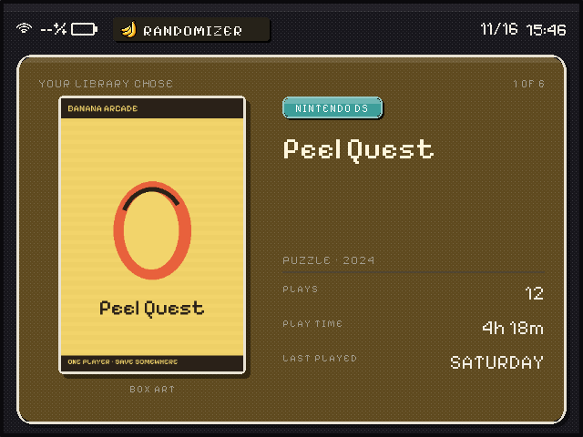
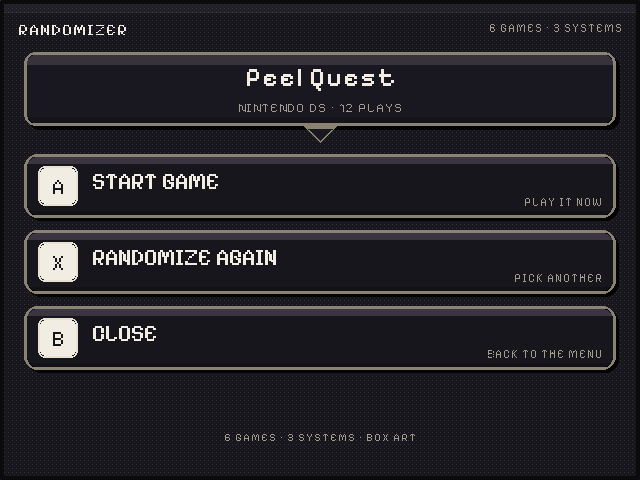
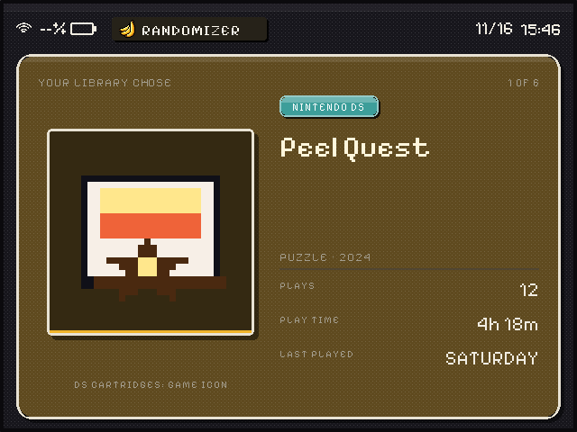

# Randomizer

One random game from the card, the moment you open it. The top screen is the game: its box art,
or the DS game's own 32×32 icon when **Settings › Display & sound › Menu look › DS cartridges**
is **Game icon**. The bottom screen has the three choices:

| | |
|---|---|
| **A** | **START GAME** — writes the game's path to `/run/banana/launch` and exits; the menu starts it exactly as A on the game would |
| **X** | **RANDOMIZE AGAIN** — another game, never the one already on screen when there is more than one |
| **B** / **START** | **CLOSE** — back to the menu |

The three rows are touch buttons too. The bottom screen is the touch panel; the top one only shows.




## What it reads, and the one thing it writes

Read (never written):

- `/run/banana/systems.conf` — the merged systems list the menu itself uses (falling back to
  `/etc/banana/systems.conf`). Systems with an absolute folder (the built-in apps, the Store's
  Apps shelf) and `banana:` pages are left out; a system hidden in the Store
  (`/data/store/hidden-systems`) or with `shelf.<id> = hide` in `settings.conf` is left out too.
- `/data/roms/<system>/` and the second card's ROM folder (`/run/banana/sd2/roms`), through the
  system's `ext`, `flat` and `folder` keys; the same two levels deep the menu scans.
- `gamelist.xml` (name, genre, release date, `thumbnail`/`image`) and `media/box/<rom>.png|jpg`,
  read the way the library reads them. `game-titles.tsv` renames a game too.
- `/data/banana/playstats.tsv` — plays, play time and last play, for the lines on the top screen.
- `/data/banana/settings.conf` — `accent`, `theme` (dark/light), `clock` (24h/12h), `timezone`,
  `ds_cart_art`, and the `shelf.<id>` visibility keys.
- The theme's `systems.cfg` and its icons (`/usr/share/banana/rnds`) — each system's own icon and
  accent colour, for the system plate and for a game with no art at all.
- The menu's DS icon cache (`/data/banana/cache/icons`) for a zipped DS game whose icon the menu
  has already drawn.

Written: `/run/banana/launch` (the chosen game's path, on START GAME only). No history, no
settings, no cover cache of its own.

## The DS cartridges setting

The menu's setting says: **Box art** (the scraped cover; the game's own icon without one) or
**Game icon** (the DS game's own 32×32 icon on every cartridge). The menu's own top screen always
keeps box art; the Randomizer applies the setting to the hero picture as well, because on this
screen the game *is* the picture:

- **Box art**: the cover, fitted to 250×300 CSS px and drawn smoothly, in the menu's cover frame.
- **Game icon**: the game's banner icon, read from the `.nds` itself, blown up on whole pixels
  (7× at 640×480, 11× on the RG DS Plus) over the frame; a DS game whose icon can't be read
  falls back to its box art, exactly as the menu's cartridge does.
- A zipped DS game uses the menu's cached icon when there is one (the menu writes it after showing
  the game); otherwise the box art.
- `.cia`/`.dsi` files have no banner; they use box art.

The plate under the cover says which one it is: `BOX ART` or `DS CARTRIDGES: GAME ICON`.



## First run

The game is picked during the app's first frame: it reads the systems, the ROM folders and the
covers, then draws. On a card with a few hundred games this is a fraction of a second; a cold
card with thousands takes longer. There is no history of picks and no "don't show this one
again" list: every open is a fresh uniform pick, and only an X reroll avoids the immediate repeat.

With no games at all, the app says so on both screens and offers only **CLOSE**; it does not
write anything.

## Build

One C++17 file, `randomizer-font.h` (Pixelify Sans baked to 1-bit glyphs), `randomizer-logo.h`
(the menu's banana) and `stb_image.h` (PNG/JPEG). No FreeType, no libdrm, no SDL, no runtime
libraries beyond libc/libstdc++.

With the cross toolchain:

```sh
make                     # banana-randomizer (aarch64-linux-gnu-g++, -static -s)
```

With [zig](https://ziglang.org) (0.14.1, what built this folder's previews):

```sh
zig c++ -target aarch64-linux-musl -std=c++17 -O2 -static -s -o banana-randomizer banana-randomizer.cpp
```

A host build, for the previews on a computer:

```sh
zig c++ -std=c++17 -O2 -o randomizer-host banana-randomizer.cpp    # or: make host
```

`--smoke PREFIX` writes `PREFIX-top.ppm` and `PREFIX-bottom.ppm` and exits. It works with
`--root`, `--systems`, `--roms`, `--assets`, `--size 1024x768`, `--accent`, `--theme`,
`--setting box|icon`, `--seed`, `--pick`, `--press a,x,b` and `--touch X,Y`.

```sh
python tools/make-testdata.py /tmp/randomizer-card
./randomizer-host --root /tmp/randomizer-card --systems /tmp/randomizer-card/systems.conf \
    --roms /tmp/randomizer-card/roms --assets ../../../ui/assets/rnds \
    --smoke /tmp/rand --pick 4
python tools/ppm2png.py /tmp/rand-top.ppm /tmp/rand-top.png
```

`tests/run.sh` builds the host and checks the scan (including what must be left out), both panel
sizes, the launch hand-off, touch, reroll, the DS icon setting and the empty states. It needs only
a C++ compiler and Python 3:

```sh
sh tests/run.sh
```

`tools/make-testdata.py` needs Pillow; the test fixture (`tests/make-card.py`) does not.

## Install

The image builds and installs it with the menu (`buildroot/package/banana-ui/banana-ui.mk`):

```
/usr/bin/banana-randomizer
/usr/share/banana/apps/randomizer/Randomizer.app
/usr/libexec/banana/run-randomizer
```

and the shelf gets it from `system/rootfs/etc/banana/systems.conf` (`[randomizer]`) plus
`ui/assets/rnds/systems.cfg` (`randomizer.png`, the die icon, accent `#e8a33d`). The launcher keeps
its log in `/data/banana/logs/randomizer.log` and rolls it at 256 KB.

On a card by hand (the root filesystem is read-only, so not `/usr/bin`): copy the ARM binary to
`/data/store/apps/randomizer/banana-randomizer`, add an empty
`/data/store/apps/randomizer/Randomizer.app` beside it, and add a section to the card's
`banana/systems.conf`:

```ini
[randomizer]
name = Randomizer
maker = Banana
folder = /data/store/apps/randomizer
ext = app
run = /data/store/apps/randomizer/banana-randomizer %ROM%
```

No tile script is needed: this is a system of its own, like Activity. The image's normal install
is the one above.

## Limits

- English only (like Activity). The strings are in the source, not a table yet.
- Titles are drawn with Pixelify Sans' Latin-1 glyphs: a Japanese, Chinese or Cyrillic title
  shows `?` where the menu's fallback font would draw it (the same limit Activity has).
- The menu's two palettes are drawn (dark/light) with the accent; a **user theme's own colours
  and per-system icons** are not read. The default theme's `rnds/systems.cfg` supplies the
  systems' accents and icons (the same limit Activity has).
- A user theme's own system icon in `themeFiles.icons` is not read; the default theme's
  `rnds/systems.cfg` icons are.
- No suspend/resume handling: if the handheld sleeps with Randomizer open, the picture can stay
  frozen until it is closed and opened again.
- The app is a child of the menu. If the menu is not running (the app is started from a shell),
  START writes the file but nothing starts the game.

## Layout of this folder

```
banana-randomizer       the aarch64 binary (built from the source here)
banana-randomizer.cpp   the app
randomizer-font.h       Pixelify Sans, baked to 1-bit glyphs (generated from ui/assets/rnds/fonts)
randomizer-logo.h       the menu's banana, baked at 1x and 1.6x
stb_image.h             PNG/JPEG decoding (nothings/stb, public domain/MIT)
Makefile                cross and host builds
README.md               this file
DESIGN.md               the visual system and the design of each screen
mockups/                the app's own renders (--smoke)
tools/
  make-testdata.py      a fake card with six made-up games and their covers
  make-font.py          regenerate randomizer-font.h from ui/assets/rnds/fonts
  make-logo.py          regenerate randomizer-logo.h from ui/assets/rnds/logo@*.png
  make-icon.py          the 32x32 die shelf icon
  ppm2png.py            PPM -> PNG
tests/
  run.sh                the app's checks
  make-card.py          a dependency-free card for them
```

Pixelify Sans is SIL OFL 1.1; the baked glyphs are derived from
`ui/assets/rnds/fonts/PixelifySans-{Regular,Medium}.ttf`.
